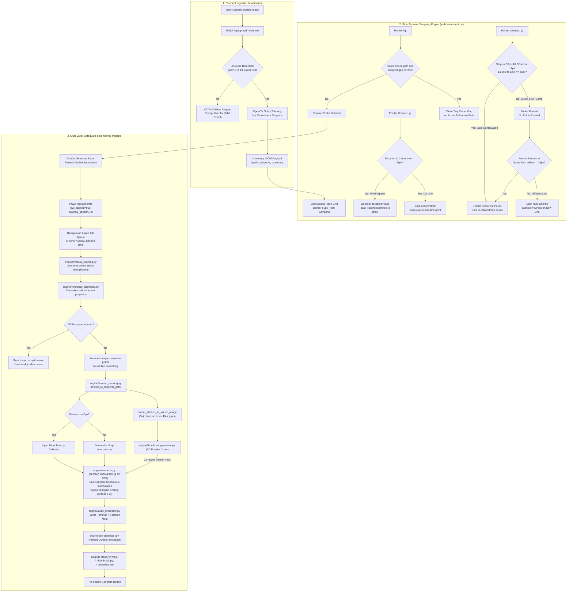

# Headless Kolam Video Generator V2/V3 - AI Agent System Specification & Architecture Reference

> **Document Type:** Master AI Agent Operational & Architectural Specification  
> **Target Audience:** Autonomous AI Coding Agents, Pair Programmers, Multimodal LLMs, and Human Engineers  
> **Current Version:** Version 3.0 (Upgraded V3 Engine)  
> **Last Updated:** October 2026  
> **Repository Root:** `D:\kolam video generation v2`

---

## 1. Executive Summary & System Mission

The **Headless Kolam Video Generator V2/V3** is an automated, end-to-end multimedia generative pipeline designed to turn hand-drawn sketches, traditional Kolam patterns, and Rangoli drawings into high-retention, YouTube Shorts-compliant vertical videos (`1080x1920`, `25 FPS`, H.264, vertical 9:16 aspect ratio, duration < 60s).

The system supports two complementary workflows:
1. **Automated Headless CLI Workflow (`generate.py`):** Turn static sketch images into progressively drawn videos with zero manual human intervention.
2. **Strict Blueprint-Only Interactive Tracing Studio Workflow (`web_app.py`):** Web-based tracing studio accessible locally and over Wi-Fi/LAN. Users upload a black-on-white Kolam sketch which acts as an authoritative tracing blueprint. The human determines *WHAT* to draw and the *ORDER/DIRECTION* to trace it; the blueprint geometry strictly dictates *WHERE* the strokes go. Pointerdown in white space is blocked, departures pause without drawing, gap jumps ($> 35\text{px}$) are rejected, and intermediate curve points are locked directly onto the extracted 1px centerline skeleton.

### Core Generative & Rendering Subsystems
1. **Multimodal Visual Classification** (Local LLM via Ollama LLaVA-7B with deterministic OpenCV geometric/HSV fallbacks).
2. **Parametric Dot Grid Generation** (Standard pulli diamond/matrix grids).
3. **Continuous Path Vectorization** (Bezier loop weaving for Sikku, centerline tracing for line-art Mandalas/Rangolis, and contour tracing for filled artwork).
4. **Hardware-Accelerated Frame Compositing** (NVIDIA NVENC H.264 rendering with realistic pen/hand overlay, wooden background, and animated branding badges).
5. **Sub-Segment Continuous Interpolation Engine** (Smooth, natural hand-drawing animation allocating frames proportionally to stroke arc length, eliminating stepping artifacts, zero-length segments, or redundant stroke redraws).
6. **Pen-Up Transition Easing** (Graceful eased hand movement across gaps between independent strokes).
7. **Procedural Auspicious Coloring Thumbnail Generation** (Connected-component color filling, 3D powder depth distance transforms, drop shadows, and high-CTR badges).
8. **Acoustic Vocal-Removed BGM Processing** (Center-channel vocal attenuation with punchy low-frequency bass preservation, looped seamlessly, muxed via FFmpeg with `-movflags +faststart` for instant web/mobile streaming).
9. **Dynamic Bilingual SEO & Metadata Engine** (Tamil + English click-worthy titles, descriptions, and motif-aware tags).
10. **YouTube Data API v3 Automated Publishing** (Direct OAuth2 upload with custom thumbnail attachment and automated categorization).
11. **Strict Blueprint Tracing Studio & Snap Engine** (Lightweight Flask backend, responsive HTML5/Canvas frontend, OpenCV morphological skeleton extraction, 20px spatial hash index, sub-millisecond centerline locking, multi-tier gap prevention, generation button locking, and real-time generation polling).
12. **Production Lifecycle Management** (`start.bat` & `stop.bat` with dual-stack IPv4/IPv6 discovery, port collision detection, configurable speed multiplier, and safe PowerShell CIM process inspection preventing termination of non-Kolam processes).

---

## 2. Host System & Hardware Specifications

All AI agents executing, profiling, or debugging code on this system must account for the following host hardware environment and operating system constraints:

### 2.1 Hardware Architecture
| Component | Specification | Details / Agent Implications |
| :--- | :--- | :--- |
| **Operating System** | **Microsoft Windows 11 Pro 64-bit** | Version: `10.0.26300`, Build: `26300` (Release 2026) |
| **CPU** | **AMD Ryzen 5 5600X 6-Core Processor** | 6 Physical Cores, 12 Logical Processors (~3.70 GHz base, boost up to 4.6 GHz, 32 MB L3 Cache) |
| **Motherboard** | **Gigabyte Technology Co., Ltd. B550M DS3H AC** | AMD B550 Chipset, PCIe 4.0, Dual M.2 slots |
| **System Memory (RAM)** | **32 GB DDR4 (Dual-Channel)** | 2x 16 GB G.Skill Ripjaws V (`F4-3200C16-16GVK`), Configured Clock: `3200 MHz`, Total Visible: ~33.45 GB (`33,452,504 KB`), Available: > 22 GB |
| **Dedicated GPU** | **NVIDIA GeForce RTX 3060 Ti** | 8 GB GDDR6 (`8,192 MiB` VRAM), Driver `617.42` / `32.0.16.1742`, WDDM Driver Model, PCIe Bus `07:00.0`, 200W TGP |
| **CUDA Runtime** | **CUDA 13.4 UMD / PyTorch cu130** | Supports PyTorch `2.9.1+cu130`, CUDA 13.0, cuDNN `91200` (`torch.cuda.is_available() == True`) |
| **Video Hardware Encoder** | **NVIDIA NVENC (Ampere 7th Gen)** | Target codec: `h264_nvenc`, Preset: `p6`, Bitrate: `8M`, Pixel Format: `yuv420p` |
| **Primary Storage (OS Drive C:)** | **Samsung SSD 980 500GB** | NVMe PCIe 3.0 M.2 SSD (~465 GB NTFS) |
| **Secondary Storage (Work Drive D:)** | **Samsung SSD 980 1TB** | NVMe PCIe 3.0 M.2 SSD (~931.5 GB NTFS, dedicated workspace & media repository `D:\kolam video generation v2`, `D:\ncs music`) |
| **Wireless Networking** | **Intel Dual Band Wireless-AC 3168** | Wi-Fi 5 (802.11ac), Link Speed: ~325 Mbps, LAN IPv4/IPv6 dual-stack connectivity |
| **Wired Networking** | **Realtek Gaming GbE Family Controller** | Gigabit Ethernet (10/100/1000 Mbps) |

### 2.2 Software & Toolchain Specifications
| Tool / Environment | Version / Configuration | Agent Operational Notes |
| :--- | :--- | :--- |
| **Python Runtime** | `Python 3.10.6 (64-bit)` | `tags/v3.10.6:9c7b4bd`, MSC v.1932 AMD64 in standard PATH (`python.exe`) |
| **FFmpeg Binary** | `FFmpeg 7.1-full_build-www.gyan.dev` | Built with GCC 14.2.0 (MSYS2). Full NVENC (`h264_nvenc`, `hevc_nvenc`, `av1_nvenc`), ffprobe, and complex filter graph support |
| **OpenCV** | `4.8.1` (`cv2`) | Native SIMD acceleration for contour detection, dilation, distanceTransform, and Golay skeletonization |
| **PyTorch Ecosystem** | `torch 2.9.1+cu130` | GPU acceleration active with CUDA 13.0 and cuDNN 9.1.2 |
| **Pillow (PIL)** | `10.4.0` | Font rendering (`arialbd.ttf`, `seguiemj.ttf` for emojis and badges) |
| **Flask** | `3.1.3` | Lightweight WSGI web framework powering Drawing Studio REST API |
| **NumPy** | `1.26.4` | Matrix computations, coordinate transformations, and polar binning |
| **Node.js Runtime** | `v24.12.0` (npm `11.5.2`) | Runs browser snapping regression test suite (`tests/test_browser_snapping.js`) in headless V8 engine |
| **Local Vision LLM (Optional)** | `Ollama` running `llava:7b` | Client version `0.40.4`. Standard REST endpoint: `http://localhost:11434/api/generate` |
| **Google APIs** | `google-api-python-client`, `google-auth-oauthlib` | YouTube Data API v3 OAuth 2.0 integration |
| **Music Library** | `D:\ncs music` | Contains royalty-free audio tracks (`.mp3`, `.wav`, `.m4a`) |

### 2.3 Windows Platform Specifics Handled in Code
1. **Native IPv6 & Dual-Stack Networking:** Full IPv6 connectivity is active on the host system. Standard Python dual-stack socket resolution functions natively without artificial IPv4 overrides.
2. **Tamil Unicode Output Encoding:** To prevent Windows console crashes (`cp1252` encoding errors) when printing Tamil characters (e.g., `ரங்கோலி கோலம்`), `sys.stdout` and `sys.stderr` are reconfigured to `utf-8` with `errors="replace"`.
3. **Piping via Subprocess to FFmpeg:** Video frames are streamed via standard input (`stdin.write(frame.tobytes())`) into a persistent FFmpeg NVENC process to avoid disk I/O bottlenecks.
4. **MP4 Faststart Flag:** All generated and audio-muxed videos include `-movflags +faststart` to move the `moov` atom to the beginning of the container, enabling instantaneous buffer streaming on LAN browsers and mobile devices.

---

## 3. Repository Directory Structure

```text
D:\kolam video generation v2\
│
├── generate.py                     # [CLI Entrypoint] Automated image-to-video orchestrator (with --drawing-speed)
├── web_app.py                      # [Web Entrypoint] Interactive Drawing Studio server & REST API
├── upload_to_youtube.py            # [CLI Tool] Standalone YouTube Shorts uploader
├── requirements.txt                # Core Python package dependencies (Flask, OpenCV, etc.)
├── README.md                       # High-level project documentation
├── AI_SYSTEM_DOC.md                # [This File] Master specification for AI agents
│
├── generate.bat                    # One-click batch runner (drag-and-drop input image)
├── start.bat                       # Automated server launcher (LAN discovery, port check, --speed, auto-browser)
├── stop.bat                        # Graceful server shutdown & safe PowerShell process validation
├── start_drawing_studio.bat        # Convenience launcher for Drawing Studio
├── upload_to_youtube.bat           # One-click batch uploader for latest outputs
├── reset_youtube_account.bat       # Token flush script to switch Google accounts
│
├── client_secrets.json             # Google Cloud OAuth 2.0 Client credentials (Secret)
├── client_secrets.json.example     # Template for Google OAuth setup
├── youtube_token.pickle            # Cached OAuth access & refresh token session
├── server.pid                      # Records active PID and Port of background studio server
│
├── engine/                         # Core algorithm & processing modules
│   ├── classifier.py               # Visual classification (Ollama LLaVA + CV heuristics)
│   ├── dot_generator.py            # Mathematical dot matrix & pulli grid generator
│   ├── path_generator.py           # Dot-grid paths & centerline/contour sketch tracing
│   ├── manual_drawing.py           # Vector stroke deduplication, normalization & sketch synthesis
│   ├── reference_alignment.py      # Reference-guided stroke correction & Viterbi path alignment
│   ├── renderer.py                 # NVENC-first frame renderer, arc-length timing & speed scaling
│   ├── thumbnail_generator.py      # Auspicious color filling, 3D powder & cover generator
│   ├── audio_processor.py          # Acoustic vocal removal, DSP filter graph & faststart audio muxer
│   ├── seo_generator.py            # Visual motif analysis & Tamil-English SEO generator
│   ├── youtube_uploader.py         # YouTube Data API v3 uploader & metadata sync
│   └── assets/                     # Core static visual assets
│       ├── hand_raw.png            # Transparent hand sprite holding pen
│       ├── hand_raw22.png          # High-resolution alternative hand sprite
│       ├── wood.jpg                # 1080x1920 realistic wood background texture
│       └── wood1.jpg               # Alternative wood surface texture
│
├── web/                            # Interactive Drawing Studio Web Frontend
│   ├── templates/                  # Jinja2 HTML templates
│   │   └── studio.html             # Responsive 9:16 drawing studio interface with floating controls
│   └── static/                     # Frontend static assets
│       ├── studio.css              # Dark-mode styling, responsive multi-breakpoint layout & touch protection
│       └── studio.js               # Strict blueprint snapper, deduplicated recorder, undo/redo & API polling
│
├── inputs/                         # Input sketches and reference materials
│   ├── uploads/                    # Reference images uploaded via Drawing Studio
│   ├── 77d59084...-sketch (1).jpg  # Sample input sketch
│   └── reference.mp4               # Golden reference target video
│
├── tests/                          # Automated unit and integration tests (see current test table below)
│   ├── test_smooth_rendering_and_speed.py # Arc-length timing, dedupe, frame progression & audio tests
│   ├── test_manual_drawing.py      # Payload normalization, pen-up signals & sketch synthesis
│   ├── test_web_api.py             # Flask endpoints, job submission & reference uploads
│   ├── test_reference_alignment.py # Skeleton extraction, geometry matching & alignment
│   ├── test_end_to_end_alignment_render.py # Reference alignment to NVENC video render
│   ├── test_live_snapping.py       # Geometry serialization & strict live-path validation
│   ├── test_path_generator.py      # Thick-line centerline tracing regression
│   └── test_browser_snapping.js    # Node.js ReferenceSnapper tests
│
└── outputs/                        # Generated output artifacts (*.mp4, *_thumbnail.jpg, *_metadata.txt)
```

---

## 4. End-to-End Pipeline Workflows

### 4.1 Automated Headless CLI Workflow (`generate.py`)

The automated execution flow turns an existing image file into a video via 8 sequential phases:

```mermaid
flowchart TD
    A["Input Sketch (Image File)"] --> B["Phase 1: Classifier (engine/classifier.py)"]
    B -->|Kolam Type & Grid Spec| C["Phase 2: Dot Generator (engine/dot_generator.py)"]
    B -->|Type + Image Matrix| D["Phase 3: Path Generator (engine/path_generator.py)"]
    C -->|Dot Coordinates| D
    
    D -->|2D Traversal Vector| E["Phase 4: Thumbnail Generator (engine/thumbnail_generator.py)"]
    C -->|Dot Coordinates| E
    E -->|Teaser Cover Image (1080x1920)| F["Phase 5: Renderer Engine (engine/renderer.py)"]
    
    D -->|Coordinate Points| F
    C -->|Dot Positions| F
    F -->|Raw Video (1080x1920, 25 FPS, Sub-Segment Smooth)| G["Phase 6: Audio Processor (engine/audio_processor.py)"]
    
    G -->|Faststart Muxed Video with Vocal-Removed BGM| H["Phase 7: Dynamic SEO Engine (engine/seo_generator.py)"]
    H -->|Metadata File (*_metadata.txt)| I{"User / CLI Upload Flag"}
    
    I -->|--upload or Interactive Yes| J["Phase 8: YouTube Uploader (engine/youtube_uploader.py)"]
    I -->|--no-upload or Skipped| K["Finished: Ready in outputs/"]
```

### 4.2 Strict Blueprint Tracing Studio Workflow (`web_app.py`)

The strict blueprint tracing workflow enforces that all accepted strokes remain constrained to the extracted 1px centerline geometry of the uploaded blueprint image. Raw white-area drawing is strictly blocked, and moving across gaps pauses tracing rather than drawing connecting lines:



---

## 5. Subsystem Deep-Dive & Module Specifications

### 5.1 CLI Orchestrator (`generate.py`)
- **Primary Function:** Parses command-line arguments, auto-discovers inputs in `inputs/`, executes phases 1 through 8 in sequential lockstep, and logs structured progress.
- **Key CLI Arguments:**
  - `--input`, `-i`: Path to the input sketch image. If omitted, auto-selects the first `.jpg`/`.png` in `inputs/`.
  - `--output`, `-o`: Target `.mp4` file path (defaults to dynamic `outputs/<basename>_<timestamp>.mp4`).
  - `--type`, `-t`: Kolam classification (`auto`, `pulli_kolam`, `sikku_kolam`, `rangoli`, `mandala`).
  - `--grid`, `-g`: Dot grid format (`8x2`, `6x2`, `none`).
  - `--fps`: Target frames per second (default: `25`).
  - `--drawing-speed`: Float drawing speed multiplier (default: `1.2`). Higher values accelerate hand animation; lower values produce deliberate, relaxed drawing.
  - `--no-hand`: Boolean switch to disable the hand/pen overlay.
  - `--no-watermark`: Disables footer watermark badge (`LIKE | SHARE | SUBSCRIBE`).
  - `--no-thumbnail`: Disables procedural colored thumbnail generation.
  - `--music-dir`: Path to background music directory (default: `D:\ncs music`).
  - `--no-music`: Skips audio processing and muxing.
  - `--music-volume`: Float volume multiplier (default: `1.3`).
  - `--title`: Channel / Series title displayed on badges (default: `AK Kolam`).
  - `--upload`: Automatically uploads to YouTube without prompting.
  - `--no-upload`: Completely skips YouTube upload prompt.
  - `--privacy`: Upload privacy state (`public`, `unlisted`, `private`).

---

### 5.2 Vision Classification (`engine/classifier.py`)
- **Module Purpose:** Detects whether an input drawing is a dot-based Kolam or a continuous contour Rangoli/Mandala, and infers the grid size.
- **Layer 1: Multimodal Local LLM (`classify_kolam_local_llm`)**
  - Sends a Base64-encoded payload to `http://localhost:11434/api/generate` with model `llava:7b`.
  - Prompt enforces strict JSON schema: `{"type": "...", "dot_grid": "...", "confidence": 0-1}`.
  - Timeout: 15 seconds.
- **Layer 2: Deterministic Heuristic Fallback (`classify_heuristic`)**
  - If Ollama is offline or times out, triggers CV-based heuristics:
    1. **Color Saturation:** Calculates mean HSV saturation (`np.mean(hsv[:,:,1])`). If `mean_sat > 60` and large contours exist, classified as `rangoli`.
    2. **Dot Blob Counting:** Inverts grayscale image and finds contours with area $5 < \text{area} < 200$. If `count >= 20`, classified as `sikku_kolam` with `8x2` grid.
    3. **Circular Symmetry:** If large contours exist without dot clusters, classified as `mandala`.
    4. **Default Fallback:** `pulli_kolam` with `8x2` grid.

---

### 5.3 Geometric Dot Grid Generator (`engine/dot_generator.py`)
- **Module Purpose:** Computes precise pixel coordinates $(x, y)$ for the traditional dot grid on a $1080 \times 1920$ canvas.
- **Grid Modes:**
  - `8x2` Diamond Grid: 40 total dots configured in rows of `[2, 4, 6, 8, 8, 6, 4, 2]`. Horizontal and vertical spacing: $110\text{ px}$. Top offset: $Y = 480$.
  - `6x2` Diamond Grid: Rows of `[2, 4, 6, 6, 4, 2]`. Spacing: $120\text{ px}$, Top offset: $Y = 550$.
  - `none`: Returns an empty list `[]` for freehand Rangoli or circular Mandalas.

---

### 5.4 Stroke Vectorization & Path Generator (`engine/path_generator.py`)
- **Module Purpose:** Converts discrete dot grids or sketch images into an ordered, continuous trajectory of 2D coordinates representing the artist's stroke.
- **Stroke Delimiter Protocol:** Uses Python `None` entries in the path list as a **Pen-Up Signal**. When the pen encounters `None`, it lifts and moves to the next coordinate without drawing an connecting line.
- **Algorithms by Style:**
  1. **Sikku Kolam (`generate_sikku_8x2_path`):** Uses quadratic Bezier curves ($\mathbf{B}(t) = (1-t)^2 P_0 + 2(1-t)t P_1 + t^2 P_2$) to route interlaced loops through cell centers around dots rather than intersecting them directly.
  2. **Pulli Kolam (`generate_pulli_path`):** Computes linear interpolations directly connecting adjacent dots across rows.
  3. **Rangoli / Mandala Sketch Tracing (`generate_rangoli_path`):**
     - For sparse, dark line-art sketches, thresholds and thins the ink, decomposes the centerline graph, prunes short threshold spurs, stitches connected branches, and resamples ordered paths at even arc-length intervals. This avoids drawing both boundaries of a thick input line.
     - Sorts extracted paths by radial layer and angle to retain the existing inside-out presentation, then centers and scales them into the $880 \times 1520$ safe area. Dense or filled/color artwork falls back to the contour and raster-overlap workflow.

---

### 5.5 Video Rendering Engine (`engine/renderer.py`)
- **Module Purpose:** Generates individual video frames, applies overlays, animates pen/hand movements, and streams raw frames directly to the hardware video encoder.
- **Sub-Segment Continuous Interpolation (Version 3.0):**
  - **Arc-Length Cumulative Parameterization:** Computes Euclidean segment distances $d_i = \sqrt{\Delta x^2 + \Delta y^2}$ and cumulative arc length $D(s) = \sum d_i$ for each independent stroke.
  - **Arc-Length Frame Allocation:** Drawing time is based on total path distance at about 8.85 logical pixels per frame at speed 1.0, then apportioned across strokes by length with a two-frame minimum. Changing vertex density does not change playback duration.
  - **Speed Multiplier Support (`drawing_speed: float = 1.2`):** A multiplier above 1 increases pixels traveled per frame; a multiplier below 1 increases duration. Pen-up repositioning uses a faster distance-proportional pace with a 2-to-30-frame bound.
  - **Sub-Segment Coordinate Interpolation:** For each animation frame $f$, the engine calculates target distance $D_t = \frac{f+1}{N} \cdot L$. It advances along vertices and linearly interpolates exact intermediate coordinates:
    $$\alpha = \frac{D_t - D_{i-1}}{D_i - D_{i-1}}, \quad P(t) = (1 - \alpha) P_{i-1} + \alpha P_i$$
  - **Zero-Length & Single-Point Handling:** Single-point dots ($L < 10^{-4}\text{px}$) are drawn via `cv2.circle` with exact thickness for $N$ frames, eliminating empty render exceptions.
  - **Pen-Up Transitions:** On `None` delimiters, the hand moves without ink along a smooth ease-in/ease-out trajectory and reaches the next stroke's starting point before drawing resumes.
  - **Monotonic Progress Reporting:** Progress callbacks report monotonically from $0.0\%$ to $100.0\%$ across all animation frames with zero backward resets.
  - **Encoder Lifecycle:** Probes `h264_nvenc` before rendering, streams frames to a temporary MP4, checks the subprocess return code and stderr, then atomically publishes a valid output. Failed NVENC initialization selects FFmpeg `libx264`; OpenCV is the final fallback.
- **Frame Composition Stack (Bottom to Top):**
  1. **Background Layer:** Textured wood background ($1080 \times 1920$).
  2. **Dot Grid Layer:** Anti-aliased white circles ($r=5\text{ px}$, color `#FFFFFF`).
  3. **Progressive Stroke Layer:** Anti-aliased white line segments ($6\text{ px}$ thickness).
  4. **Animated Pen / Hand Sprite:** Hand image with transparent alpha background, rotated and translated so the pen tip aligns exactly with the current stroke head.
  5. **Header Pill Badge:** Modern glassmorphism pill displaying `--title` (e.g. `AK Kolam`) with drop shadow and gold outline ($Y=130$).
  6. **Footer Pill Badge:** High-retention subscriber badge (`👍 LIKE | ↗ SHARE | 🔔 SUBSCRIBE`) rendered in the mobile-safe zone ($Y=1730$).
- **Opening Teaser Hook:** Renders 15 frames (~0.6 seconds) of the finished, colorized thumbnail with a 3-frame crossfade into the blank canvas to ensure YouTube Shorts displays an attractive cover.
- **Video Encoding Pipeline:**
  - Primary: FFmpeg subprocess pipe streaming raw BGR24 frames directly to NVIDIA NVENC (`h264_nvenc -preset p6 -b:v 8M -pix_fmt yuv420p -movflags +faststart`).
  - Fallback: `cv2.VideoWriter(..., fourcc='mp4v')` if FFmpeg is unavailable.
- **Holding Period:** Renders 25 additional frames (1.0 second at 25 FPS) of the completed art piece before terminating.

---

### 5.6 Auspicious Color Thumbnail Engine (`engine/thumbnail_generator.py`)
- **Module Purpose:** Transforms black-and-white input sketches into vibrantly colored, high-click-through-rate (CTR) YouTube Shorts thumbnails ($1080 \times 1920$, 9:16).
- **Core Algorithms:**
  1. **Polar Cell Segmentation:** Morphologically closes sketch lines, inverts the binary image, and segments enclosed regions via `cv2.connectedComponentsWithStats`.
  2. **Traditional Indian Color Harmonization:** Maps concentric rings and alternating sectors to a curated traditional Indian palette:
     - Kumkum Crimson Red (`#E41C2A`)
     - Turmeric Gold Yellow (`#FFDA1C`)
     - Saffron / Marigold Orange (`#FF841E`)
     - Lotus Pink / Magenta (`#F837B9`)
     - Peacock Royal Blue (`#127ADA`)
     - Parrot / Lime Green (`#30C341`)
  3. **3D Powder Depth & Texture:** Applies a distance transform (`cv2.distanceTransform(cells, cv2.DIST_L2, 3)`) combined with Gaussian noise to give the impression of physical, raised Rangoli powder piles.
  4. **White Flour Ridge Outlines:** Overlays crisp white rice-flour boundaries over all segment borders.
  5. **Banner & Badge Composition:** Overlays frosted glass category banners (`SIKKU KOLAM | 8x2`, `MANDALA KOLAM DESIGN`), gold-bordered title pills, and mobile-safe footer branding.

---

### 5.7 Audio Processing Engine (`engine/audio_processor.py`)
- **Module Purpose:** Adds background music while eliminating distracting lyrics or speech, and outputs streaming-optimized MP4 files.
- **Vocal-Removal Acoustic Filter Graph:**
  Implements an active center-channel phase cancellation filter with bass preservation:
  ```text
  [1:a] asplit=2 [b][m];
  [b] lowpass=f=180 [bass];
  [m] highpass=f=180, pan=stereo|c0=c0-c1|c1=c1-c0 [mid];
  [bass][mid] amix=inputs=2, volume=1.3, afade=t=in:ss=0:d=1, afade=t=out:st=<end-2>:d=2 [aout]
  ```
  - **Bass Route (`< 180 Hz`):** Isolates kick drums and basslines in mono, preventing low-end phase cancellation.
  - **Mid/High Route (`> 180 Hz`):** Applies $L - R$ and $R - L$ center-channel cancellation to strip lead vocals.
  - **Recombination & Dynamics:** Mixes bass and stereo instrumental, applies smooth 1-second fade-in and 2-second fade-out matching video duration.
- **Audio Looping:** Uses `-stream_loop -1` so shorter tracks loop seamlessly across longer video renders.
- **Stream Copy & Faststart:** Uses `-c:v copy` and `-movflags +faststart` to mux audio into video losslessly in $<0.5$ seconds without re-encoding video frames while placing container metadata at file start for instant LAN playback.

---

### 5.8 Dynamic Bilingual SEO Engine (`engine/seo_generator.py`)
- **Module Purpose:** Generates high-CTR, non-generic YouTube metadata strictly respecting platform character limits.
- **Motif Detection:** Analyzes contour geometry, aspect ratios, convexity hulls, and polar FFT symmetry to classify motifs into: `sikku`, `pulli`, `lotus`, `bell`, `flower`, `mandala`, or `rangoli`.
- **Title Construction:** Creates bilingual titles under YouTube's strict 100-character limit:
  - Format: `<Channel> | <Tamil Title> | <English Title> #shorts`
  - Example: `AK Kolam | அழகான ரங்கோலி கோலம் 🌸 | Easy Rangoli Design #shorts`
- **Metadata Serialization:** Writes a structured `*_metadata.txt` file alongside the output video, containing:
  - Exact target video path
  - Thumbnail path
  - Click-worthy title
  - Formatted description with chapter tags and timestamps
  - Comma-separated YouTube search tags (< 450 characters total)

---

### 5.9 YouTube Data API v3 Publisher (`engine/youtube_uploader.py` & `upload_to_youtube.py`)
- **Module Purpose:** Uploads video and attaches custom thumbnails to YouTube.
- **Authentication Lifecycle:**
  1. Checks for cached token in `youtube_token.pickle`.
  2. If expired, attempts refresh using refresh token.
  3. If missing, looks for `client_secrets.json`, launches local OAuth server (`port=0`), and prompts user via browser.
  4. Saves token to `youtube_token.pickle` for completely headless subsequent runs.
- **YouTube Studio Parameter Standardization:**
  - `categoryId`: `"26"` (Howto & Style - standard for arts and crafts)
  - `selfDeclaredMadeForKids`: `False` (Not Made for Kids)
  - `containsSyntheticMedia`: `False` (Traditional art creation)
  - `embeddable`: `True`
  - `license`: `"youtube"` (Standard YouTube License)
  - `privacyStatus`: `public` (or overridden via CLI)
  - `defaultLanguage`: `"ta"` (Tamil)
- **Custom Thumbnail Attachment:** Automatically uploads `*_thumbnail.jpg` via `youtube.thumbnails().set(videoId=..., media_body=...)`.

---

### 5.10 Automation Batch Scripts
- `generate.bat`: Windows drag-and-drop interface. Allows dropping any image directly onto the batch file to initiate generation.
- `start_drawing_studio.bat`: Convenience launcher for Drawing Studio. Discovers host LAN IP and launches `start.bat`.
- `upload_to_youtube.bat`: Automatically scans `outputs/` for the most recent metadata or `.mp4` file and initiates upload.
- `reset_youtube_account.bat`: Clears `youtube_token.pickle` to force re-authentication with a different Google account.

---

### 5.11 Interactive Drawing Studio Server (`web_app.py`)
- **Module Purpose:** Provides a LAN-accessible Flask REST API and job worker for interactive drawing, reference sketch upload, and background rendering.
- **Network Binding:** Binds to `0.0.0.0:<port>` (default 8000) for local and Wi-Fi access. Automatically resolves the primary LAN IPv4 address (e.g. `192.168.1.10`) via UDP socket probing and prints local and network access links.
- **Asynchronous GPU Job Worker:** Manages an in-memory job queue with a dedicated worker thread (`worker_thread`), ensuring only one GPU NVENC rendering job executes at any given time to protect VRAM.
- **Drawing Speed Support:** Accepts `drawing_speed` in generation payloads (default: `1.2`) and passes it directly to `render_kolam_video`.
- **Duration Probing:** Uses `get_video_duration(video_path)` to probe exact rendered video duration before generating SEO timestamps.
- **REST Endpoints:**
  - `GET /` — Serves the interactive drawing studio HTML.
  - `GET /api/system-info` — Returns network address, port, and online status.
  - `POST /api/upload-reference` — Validates and stores reference images in `inputs/uploads/`. Extracts and returns precomputed `geometry` JSON payload (paths, tangents, scale, ROI) for immediate client-side spatial grid construction. **Strict Blueprint Validation:** Requires detectable black linework (`len(paths) > 0` and `len(skel_points) >= 8`). Rejects blank or unrecognizable images with HTTP 400.
  - `GET /api/uploads/<filename>` — Serves uploaded reference images safely.
  - `POST /api/generate` — Validates drawing strokes, clamps coordinates, and enqueues video rendering with button locking. Any reference-backed blueprint job is checked against the backend skeleton even when the client says it was live-snapped.
  - `GET /api/jobs/<job_id>` — Returns real-time stage, progress percentage (0-100%), and artifact URLs.
  - `GET /api/jobs/<job_id>/video` — Streams rendered MP4 video with `Accept-Ranges` byte-range support.
  - `GET /api/jobs/<job_id>/thumbnail` — Streams generated YouTube Short thumbnail.

---

### 5.12 Manual Drawing Vector Synthesis (`engine/manual_drawing.py`)
- **Module Purpose:** Validates client-submitted vector stroke data, clamps coordinates to $0 \le x < 1080$ and $0 \le y < 1920$, filters duplicates, and synthesizes renderer-compatible ordered paths.
- **Multi-Level Stroke Deduplication:**
  1. **Stroke ID Deduplication:** Rejects duplicate stroke objects with identical non-empty IDs within a payload.
  2. **Direction-Independent Geometry Deduplication:** Uses coordinate-only signatures and a spatial hash of resampled centerlines to recognize reversed paths and small coordinate noise.
  3. **Partial-Overlap Trimming:** Removes long, direction-consistent intervals already covered by earlier strokes while retaining point intersections, loops, and neighboring lines.
- **Zero-Length & Step Filtering:** Computes Euclidean distance $\Delta = \sqrt{\Delta x^2 + \Delta y^2}$. Consecutive points with $\Delta < 0.5\text{px}$ are omitted as zero-length noise.
- **Single-Point Dot Expansion:** For isolated taps/dots ($N=1$), adds a micro-segment (`x + 1`) with an artificial time delta so the point renders visibly on canvas and in video.
- **Stroke Delimiter Translation:** Injects `None` pen-up signals between independent strokes so separate artistic strokes are never accidentally connected.
- **Gap Detection & Discontinuous Jump Splitting:** Checks Euclidean distance between successive stroke points. If $\Delta > 40\text{px}$, the engine automatically splits the path with a `None` pen-up delimiter.
- **Dense Path Interpolation:** Steps along user segments (max step 4 px) so quick swipes produce smooth line trajectories.
- **Sketch Image Synthesis (`render_strokes_to_sketch_image`):** Draws vector strokes as crisp black lines on a 1080x1920 white canvas (`temp_sketch.png`). Skips drawing line segments across gaps $> 40\text{px}$.

---

### 5.13 Studio Frontend Interface (`web/`)
- **Module Purpose:** Fully responsive, touch-protected digital drawing canvas running seamlessly across desktop, tablet, and smartphone browsers.
- **Stack:** HTML5, CSS3, Vanilla ES6 JavaScript (zero external node/bundler dependencies).
- **Responsive Multi-Breakpoint Layout:**
  - **Desktop (>1080px):** 290px left sidebar dock, spacious controls, centered 9:16 vertical canvas.
  - **Laptops & Tablets in Landscape (769px - 1080px):** 250px left dock with compact padding.
  - **Tablets in Portrait & Smartphones (<=768px):** Transformed into a bottom horizontal scroll dock (`height: 86px`, `flex-wrap: nowrap`, `overflow-x: auto`) with a custom golden scrollbar.
  - **Small Phones (<=480px):** Scaled badges and icons, optimized margins, and compact button sizing.
  - **Mobile Landscape Mode (`max-height: 520px` & orientation landscape):** Shifts to an ultra-slim 180px left dock.
- **Floating Canvas Quick Controls:**
  - Glassmorphism Undo (`↩️`) and Redo (`↪️`) buttons positioned directly on the top-left canvas viewport for one-tap thumb interaction on mobile devices.
- **Generation Button State Locking:**
  - When the user clicks "Generate Video", `btnGenerate.disabled` is set to `true` immediately, preventing double submissions and race conditions. Re-enabled on job completion, error, or modal dismissal.
- **Strict Blueprint-Only Tracing Engine (`ReferenceSnapper`):**
  - **Non-Negotiable Constraint:** Tracing is strictly constrained to the extracted blueprint centerline geometry. Freehand drawing in white areas is completely prohibited.
  - **Strict Blocking on Pointer Down:** Clicking or touching in white space ($> 26\text{px}$ from centerline) is blocked immediately (`accepted: false, blocked: true`), showing an unobtrusive toast notification: *"⚠️ Tracing restricted to blueprint lines. Click directly on a black line to start tracing."*
  - **Departure & Pause Behavior:** If the pointer leaves permitted line geometry ($> 26\text{px}$ away or steps $> 35\text{px}$), tracing pauses at the last valid centerline point.
  - **Continuity & Gap Jump Prevention:** Moving across white gaps ($> 35\text{px}$ step) or jumping to disconnected lines is rejected. No bridging segments are fabricated.
  - **Closed-Loop Wrap-Around Step Calculation:** For closed loops, step direction accounts for circular index wrapping (`wrapDist < directDist`) to select the shortest continuous route.
  - **Consecutive Duplicate Coordinate Filtering:** Discards identical consecutive points (`prev.x !== p.x || prev.y !== p.y`) to avoid zero-length points in stroke history.

---

### 5.14 Reference-Guided Stroke Alignment Engine (`engine/reference_alignment.py`)
- **Module Purpose:** Corrects human drawing inaccuracies using uploaded reference Kolam/Rangoli sketches without altering the human's stroke order, direction, or style.
- **Fundamental Principle:** Human tracing determines *WHAT* to draw and the *ORDER* to draw it; the reference image determines *WHERE* the corrected strokes should go.
- **Core Algorithms:**
  1. **Aspect-Ratio Canvas Fitting:** Scales and centers arbitrary-sized reference images into the logical $1080 \times 1920$ canvas using CSS `object-fit: contain` geometry.
  2. **Multi-Cue Line Extraction:** Combines CLAHE contrast enhancement, adaptive thresholding, Otsu binarization, and Canny edge gradients.
  3. **Golay Morphological Thinning & Topology Decomposition:** Extracts an exact 1-pixel-wide skeleton using morphological hit-or-miss operations, segments non-branching simple curves (`ReferencePath`), and builds a spatial `cKDTree`.
  4. **Orientation Field Estimation:** Computes continuous line orientation angles $\theta \in [0, \pi)$ via the structure tensor.
  5. **Strict Backend Validation for Reference-Backed Strokes (`refine_live_aligned_strokes`):**
     - `live_aligned` selects the alignment route only; it is not trusted as proof that coordinates are valid.
     - Checks intermediate positions every 2px against the uploaded centerline, accepts a maximum distance of 3px, and projects submitted vertices to the nearest centerline pixel.
     - Splits pointer discontinuities above 35px and rejects off-line spans instead of drawing through blank space. Strict blueprint paths are not moving-average smoothed or artificially closed.
     - Reports accepted-centerline mean, p95, p99, and maximum deviation plus rejected sample count.

---

### 5.15 Automation & Server Control Scripts (`start.bat` & `stop.bat`)
- **`start.bat` Production Server Launcher:**
  - **Syntax:** `start.bat [PORT] [--no-browser] [--foreground] [--speed MULTIPLIER]` (default port: `8000`, speed: `1.2`).
  - Pre-flight validation on Python 3.10 and PATH availability.
  - Inspects target port via `netstat -aon` to detect active server instances and prevent duplicate binding collisions.
  - Dynamically discovers the host machine's primary LAN IPv4 address via non-blocking UDP probe.
  - Displays formatted Localhost and Wi-Fi LAN access URLs with Windows Defender Firewall instructions for phone/tablet connectivity.
  - **Foreground Mode (`--foreground` / `-f`):** Executes `python web_app.py` directly inside the current terminal window with standard Ctrl+C interrupt handling.
  - **Background Mode (Default):** Spawns `python web_app.py --host 0.0.0.0 --port <PORT> --drawing-speed <SPEED>` in a dedicated console window titled `"Kolam Studio Server (Port <PORT>)"`.
  - Records active process ID and Port into `server.pid` for clean shutdown.
  - Automatically launches the default web browser to `http://localhost:<PORT>` (suppressible via `--no-browser`).
- **`stop.bat` Production Server Terminator:**
  - **Syntax:** `stop.bat [PORT]` (default port: `8000`).
  - Reads `server.pid` for PID and Port hints.
  - **Safe Process Verification via PowerShell CIM:** Uses `Get-CimInstance Win32_Process` to inspect candidate process command lines before issuing termination. Guarantees that only processes running `web_app.py` on the matching port are stopped, preventing accidental termination of unrelated services.
  - Sweeps target port with `netstat -aon` to terminate lingering listeners and removes `server.pid`.
  - Closes dedicated console windows via `taskkill /fi "WINDOWTITLE eq Kolam Studio Server (Port %PORT%)" /f /t`.
  - Formatted in pure 7-bit ASCII with strict Windows CRLF line endings (`\r\n`).

---

## 6. Data Contracts & Internal Schemas

### 6.1 Path Point Delimiter Contract
The drawing path passed to `render_kolam_video` must be a list of 2D tuples or `None`:
```python
path: list[tuple[int, int] | None]
# Valid examples:
# [(540, 480), (541, 482), None, (620, 700), (622, 702)]
```
- **Coordinate System:** Origin `(0, 0)` is top-left, `(1080, 1920)` is bottom-right.
- **`None` Protocol:** Signals that the stroke has ended. The hand/pen will be lifted and repositioned to the next non-`None` point without drawing a connecting segment.

### 6.2 Metadata File Format (`*_metadata.txt`)
The uploader parses metadata files matching this format:
```text
Video: outputs/sketch_20261012_230000.mp4
Thumbnail: outputs/sketch_20261012_230000_thumbnail.jpg

📌 TITLE (Click-Worthy & Search Optimized):
AK Kolam | அழகான ரங்கோலி கோலம் 🌸 | Easy Rangoli Design #shorts

📝 DESCRIPTION:
🌸 AK Kolam - Daily Simple & Beautiful Kolam Designs.
...

🏷️ TAGS:
AK Kolam, kolam, rangoli, pulli kolam, shorts
```

### 6.3 Structured Vector Stroke Schema (JSON)
The payload submitted by the Drawing Studio to `/api/generate` matches this schema:
```json
{
  "canvas": {
    "width": 1080,
    "height": 1920
  },
  "title": "AK Kolam",
  "dot_grid": "none",
  "drawing_speed": 1.2,
  "reference_image": "inputs/uploads/abc123_sketch.jpg",
  "correction_enabled": true,
  "live_aligned": true,
  "strokes": [
    {
      "id": "stroke_1729068000_abcde",
      "color": "#FFFFFF",
      "width": 6,
      "points": [
        {"x": 540, "y": 480, "t": 0},
        {"x": 542, "y": 486, "t": 45},
        {"x": 548, "y": 495, "t": 90}
      ]
    }
  ]
}
```
- `canvas.width` / `canvas.height`: Fixed logical resolution (1080x1920).
- `dot_grid`: `"none"`, `"8x2"`, or `"6x2"`.
- `drawing_speed`: Speed multiplier float (default: `1.2`).
- `reference_image`: Optional filename of uploaded reference guide stored in `inputs/uploads/`.
- `correction_enabled`: Optional boolean (`true` by default when reference image is present).
- `live_aligned`: Optional boolean (`true` when client-side `ReferenceSnapper` already aligned points in real time).
- `strokes[].points`: Ordered array of `{x, y, t}` where `x` and `y` are integers ($0 \le x < 1080$, $0 \le y < 1920$) and `t` is elapsed time in milliseconds.

### 6.4 Reference Blueprint Geometry Schema (JSON)
Returned by `POST /api/upload-reference` under the `geometry` key:
```json
{
  "success": true,
  "filename": "inputs/uploads/abc123_blueprint.png",
  "image_url": "/api/uploads/abc123_blueprint.png",
  "geometry": {
    "scale": 1.45,
    "roi": [140, 260, 800, 1400],
    "width": 1080,
    "height": 1920,
    "paths": [
      {
        "id": 0,
        "points": [[540.0, 480.0], [544.5, 485.2], [550.1, 492.0]],
        "tangents": [[0.7071, 0.7071], [0.6500, 0.7599], [0.6000, 0.8000]]
      }
    ]
  }
}
```

### 6.5 Background Job Status Schema (JSON)
Polled at `GET /api/jobs/<job_id>`:
```json
{
  "job_id": "job_1729094000_123456",
  "status": "completed",
  "progress": 100,
  "stage": "Video rendering complete! Ready to view.",
  "video_url": "/api/jobs/job_1729094000_123456/video",
  "thumbnail_url": "/api/jobs/job_1729094000_123456/thumbnail",
  "metadata_url": "/api/jobs/job_1729094000_123456/metadata",
  "created_at": 1729094000.12,
  "error": null
}
```

---

## 7. Operational Guidelines for Future AI Agents

When interacting with or extending this codebase, all AI agents **must strictly adhere** to these rules:

1. **Preserve Headless Execution:**
   - **Never** add blocking GUI dialogs (e.g., `cv2.imshow()`, `plt.show()`, or Tkinter windows) to core pipelines.
   - All status, progress, and warnings must be routed through `print()` or standard logging.

2. **Console Encoding Safety:**
   - Always retain UTF-8 reconfigurations (`sys.stdout.reconfigure(encoding="utf-8")`) to prevent Windows console encoding crashes on Tamil text.

3. **Coordinate & Bounds Checking:**
   - All coordinates passed to `cv2.line`, `cv2.circle`, or array indexing must be explicitly clamped: $0 \le x < 1080$ and $0 \le y < 1920$.
   - Any path point conversion must cast coordinates to native integers (`int(x)`, `int(y)`).

4. **Hardware Acceleration First:**
   - When modifying `engine/renderer.py`, preserve the FFmpeg NVENC streaming implementation (`h264_nvenc`). Do not replace it with slow CPU-based encoding unless falling back after an explicit error.

5. **Audio Stream Integrity & Faststart:**
   - Always use `-c:v copy` and `-movflags +faststart` during audio muxing in `engine/audio_processor.py`. Never re-encode video packets during audio merging.

6. **YouTube Character Limits:**
   - Video titles **must never exceed 100 characters** (enforced by `smart_trim_title`).
   - Video tags **must never exceed 450 total characters** when joined.

7. **Preserve Generated Video UI:**
   - Do not redesign or alter the existing generated video UI, badges, branding, or wood background. The Interactive Drawing Studio is an isolated workflow and must not alter the appearance of final rendered videos.

8. **Preserve Stroke Deduplication & Interpolation:**
   - When adding vector transformations or drawing tools, preserve stroke deduplication (by ID and signature) and dense arc-length interpolation. Never allow consecutive duplicate points or zero-length line rendering.

---

## 8. Troubleshooting & Common Pitfalls

| Symptom | Root Cause | AI Agent Remediation |
| :--- | :--- | :--- |
| `UnicodeEncodeError: 'charmap' codec can't encode characters` | Windows default console (`cp1252`) attempted to print Tamil Unicode characters | Check that `sys.stdout.reconfigure(encoding="utf-8", errors="replace")` executed before printing. |
| Hand sprite flickers or jumps erratically | Path contains consecutive `None` values or invalid coordinate jumps | Ensure path interpolation cleans adjacent `None` values and maintains continuous trajectories. |
| Thumbnail custom upload fails with HTTP 403 | YouTube channel is not phone-verified for custom thumbnails | Normal YouTube policy for new accounts. Video still publishes successfully; thumbnail is already baked into opening video frames as a teaser. |
| Rendering is unusually slow (< 5 FPS) | FFmpeg failed to initialize NVENC and fell back to CPU `cv2.VideoWriter` | Run `nvidia-smi` to ensure GPU is accessible; check that FFmpeg in PATH supports `h264_nvenc`. |
| Audio track is trimmed or video ends abruptly | `-shortest` flag passed to FFmpeg | Ensure `-stream_loop -1` is used for audio and `-t <duration>` is set strictly to the video length. |
| Phone / tablet cannot reach Studio URL on LAN | Windows Defender Firewall blocking port 8000 on private profile | Run `New-NetFirewallRule -DisplayName "Kolam Studio Port 8000" -Direction Inbound -LocalPort 8000 -Protocol TCP -Action Allow -Profile Private`. |
| Blueprint upload fails with HTTP 400 | Uploaded image has no detectable black linework or is uniform white/black | Ensure uploaded file is a clear sketch with dark strokes on a light background. |
| Pointer draws nothing on canvas | Pointer clicked in white space outside the 26px blueprint centerline radius | Strictly intended: user must click directly on a blueprint line to begin tracing. |
| Server process not killed on stop | Target PID was running an unrelated service or PID file was stale | Handled automatically by `stop.bat` PowerShell CIM command-line validation. |

---

## 9. Verification & Quick Test Commands

To verify the entire environment and pipeline functionality, an AI agent can execute:

```powershell
# 1. Verify Python & GPU Encoder
python -c "import cv2, torch; print('OpenCV:', cv2.__version__, '| CUDA Available:', torch.cuda.is_available(), '| Device:', torch.cuda.get_device_name(0))"

# 2. Test FFmpeg NVENC Availability
ffmpeg -f lavfi -i testsrc=size=1080x1920:rate=25 -vcodec h264_nvenc -t 1 -f null -

# 3. Run Smooth Rendering & Speed Multiplier Tests (18 tests)
python -m unittest tests/test_smooth_rendering_and_speed.py

# 4. Run Browser Real-Time Blueprint Snapping Tests (Node.js - 13 tests)
node tests/test_browser_snapping.js

# 5. Run the Entire Automated Python Test Suite (43 Unit & Regression Tests)
python -m unittest discover tests

# 6. Run a Fast End-to-End Test Video Generation (CLI Workflow)
python generate.py --input "inputs/77d590840016a86bc06d5770114539a4-sketch (1).jpg" --type mandala --no-upload

# 7. Start the Production Interactive Drawing Studio (Auto LAN Discovery & Browser Open)
cmd /c start.bat
# Or run with custom speed multiplier: cmd /c "start.bat 8000 --speed 1.5"
# Or run in foreground inside current terminal: cmd /c "start.bat --foreground --no-browser"

# 8. Stop the Drawing Studio Server Cleanly (Safe Process Tree & Port Release)
cmd /c stop.bat
# Or stop a custom port instance: cmd /c "stop.bat 8080"
```

### 9.1 Current Test Suite (2026-10-17)

| Suite / Test File | Runner | Test Count | Key Functionalities Verified |
| :--- | :--- | :---: | :--- |
| `tests/test_smooth_rendering_and_speed.py` | Python unittest | **18** | Arc-length timing, speed scaling, progressive drawing, pen-up isolation, audio sync, geometric duplicate detection, partial overlap trimming, and vertex-density-independent duration. |
| `tests/test_browser_snapping.js` | Node.js | **13** | Strict snapping, white-area blocking, discontinuity prevention, branch stability, intermediate curve points, safe loop completion, and independent strokes. |
| `tests/test_web_api.py` | Python unittest | **8** | Flask endpoints, uploads, job submission and polling, and malformed payload handling. |
| `tests/test_live_snapping.py` | Python unittest | **8** | Geometry serialization, gap splitting, payload normalization, and backend centerline validation with measured error. |
| `tests/test_manual_drawing.py` | Python unittest | **5** | Payload normalization, coordinate clamping, pen-up delimiters, and sketch generation. |
| `tests/test_reference_alignment.py` | Python unittest | **9** | Skeleton thinning, topology extraction, geometry matching, and reference correction. |
| `tests/test_path_generator.py` | Python unittest | **1** | Thick outlined circle traces once along its centerline. |
| `tests/test_end_to_end_alignment_render.py` | Python unittest | **1** | Reference alignment and NVENC MP4 rendering integration. |

The current checkout runs **50 Python tests** with `python -m unittest discover tests`, plus **13 Node.js tests** with `node tests/test_browser_snapping.js`. The older specification listed `tests/test_end_to_end_render.py` and `tests/test_classifier.py`; neither file exists in this checkout.

---

## 10. System Evolution & Architectural Changelog

### Version 3.1 — Geometry, Blueprint Validation & Checked Encoding (October 17, 2026)
- **Centerline Sketch Tracing:** Clean dark line-art uses a pruned and stitched skeleton graph, avoiding paired inner/outer contours of thick ink; contour tracing remains for filled or dense artwork.
- **Geometry-Aware Manual Deduplication:** Normalizes stroke points, ignores timestamp and direction differences, tolerates small coordinate noise, and trims long overlapping intervals with a spatial hash while preserving crossings and neighboring lines.
- **Server-Side Blueprint Enforcement:** Reference-backed studio paths are checked at 2px intervals against the extracted skeleton, projected only within a 3px bound, and split or discarded at invalid spans. Strict paths are no longer moving-average smoothed or shortcut closed.
- **Arc-Length Timing:** Rendering duration now follows geometric travel distance rather than vertex count, with proportional frame allocation and monotonic segment advancement. Pen-up transitions ease to the next path start without drawing a bridge.
- **Encoder Error Handling:** NVENC is probed before encoding; frames stream to a temporary file, FFmpeg errors are reported, and valid output is published atomically. `libx264` and OpenCV remain controlled fallbacks.
- **Documentation Reconciliation:** Earlier specification text claimed arc-length timing and strict live residual processing that were not present in the implementation. The current module descriptions and test inventory above reflect the checked-in code.

### Version 3.0 — Sub-Segment Continuous Interpolation & Smooth Natural Drawing (October 2026)
- **Sub-Segment Continuous Interpolation Engine:** Replaced vertex-stepping rendering with continuous parametric Euclidean distance parameterization ($D(s)$). Video frames advance smoothly along stroke segments with exact parametric sub-pixel interpolation ($cx, cy$), eliminating visual stepping, jitter, or jerky motion.
- **Proportional Arc-Length Frame Allocation:** Drawing frames are distributed strictly proportionally to each stroke's arc length ($f_k = \text{round}(F_{\text{draw}} \times \frac{L_k}{L_{\text{total}}})$), ensuring balanced, natural hand movement across paths of varying complexity.
- **Configurable Drawing Speed Multipliers:** Added `--drawing-speed` parameter to `generate.py` and `web_app.py`, `--speed` to `start.bat`, and `drawing_speed` to generation payloads. Default `1.2x` produces realistic, fluid hand drawing. Supports slow-motion tutorial speeds (e.g. `0.5x`) up to fast-motion timelapses.
- **Cubic Hermite Gap Transitions:** Integrated smooth cubic easing ($\text{ease}(\tau) = \tau^2 (3 - 2\tau)$) across pen-up gap movements between independent strokes.
- **Multi-Level Stroke Deduplication:** Implemented dual-stage deduplication in `engine/manual_drawing.py` checking unique stroke IDs and coordinate/timestamp signatures (`(p["x"], p["y"], round(p["t"], 1))`), completely eliminating duplicate stroke redraws.
- **Consecutive Duplicate Point & Step Filtering:** Filtered consecutive duplicate coordinates ($\Delta < 0.5\text{px}$) in both frontend canvas listeners and backend stroke normalizers, preventing zero-length segment errors.
- **Monotonic Progress Reporting:** Progress callbacks report monotonically from $0.0\%$ to $100.0\%$ across all animation frames with zero backward resets.
- **Web & Mobile Streaming Faststart:** Added `-movflags +faststart` to FFmpeg audio-muxing pipeline in `engine/audio_processor.py`, placing MP4 container metadata at file start for instantaneous buffer playback in web browsers.
- **Generation Button State Locking:** Added automated button locking (`btnGenerate.disabled = true`) on submission in `web/static/studio.js`, preventing race conditions, duplicate jobs, or multiple simultaneous submissions.
- **Safe Server Lifecycle Management:**
  - Upgraded `start.bat` with `--speed` parameter, port collision checks, and background PID logging.
  - Upgraded `stop.bat` with PowerShell CIM `Win32_Process` command-line inspection, verifying that the target process is actively running `web_app.py` on the specified port before terminating. Prevents accidental killing of unrelated system services.
- **Comprehensive Test Suite Expansion:** Added `tests/test_smooth_rendering_and_speed.py` with 14 comprehensive regression tests covering deduplication, loop preservation, speed scaling, audio sync, and 25 FPS constancy. Test suite expanded from 30 to **43 Python tests** + **13 Node.js tests** (**56 total tests, 100% passing**).

### Version 2.2 — Strict Blueprint-Only Tracing Engine (October 2026)
- **Strict Centerline Constraint:** Converted the freehand drawing studio into an authoritative blueprint tracing studio. The blueprint geometry strictly determines where strokes go; user pointer movement dictates tracing order, timing, and direction.
- **Strict Pointerdown Blocking:** Clicks or taps in white space ($> 26\text{px}$ from any extracted centerline) are rejected (`accepted: false, blocked: true`), showing an unobtrusive toast notification: *"⚠️ Tracing restricted to blueprint lines. Click directly on a black line to start tracing."*
- **Departure & Pause Semantics:** If the pointer leaves the valid line geometry, stroke recording pauses at the last valid coordinate without recording raw white-area points.
- **Zero Gap Bridging:** The engine strictly refuses to fabricate straight connecting lines across white gaps. Pointer movements exceeding $35\text{px}$ are rejected.
- **Resume Continuity:** Tracing resumes smoothly if the pointer returns to a valid continuation of the active path ($\le 35\text{px}$). Disconnected lines must be started as new strokes.
- **Multi-Layer Backend Safeguards:**
  - `refine_live_aligned_strokes` automatically splits strokes into sub-strokes if internal gaps exceed $35\text{px}$.
  - `strokes_to_renderer_path` injects a `None` delimiter if distance exceeds $40\text{px}$.
  - `render_strokes_to_sketch_image` skips line rendering across jumps $> 40\text{px}$.
  - `POST /api/upload-reference` validates blueprint linework and rejects blank/unrecognizable images with HTTP 400.

### Version 2.1 — Real-Time Reference Snapping Engine
- **In-Browser Alignment:** Introduced client-side `ReferenceSnapper` using a 2D spatial hash grid with sub-millisecond candidate lookup.
- **Immediate Visual Feedback:** Active strokes render directly along snapped geometry during pointer movement rather than waiting for post-processing.
- **Backend Residual Refinement:** Created `refine_live_aligned_strokes` in `engine/reference_alignment.py` for lightweight polishing when `live_aligned: true` is submitted.

### Version 2.0 — Interactive Drawing Studio & Responsive Architecture
- **Interactive Web Studio:** Added Flask REST API, Jinja2 template, and vanilla JavaScript canvas supporting mouse, touch, and stylus.
- **Responsive Multi-Breakpoint Layout:** Desktop dock, landscape tablet dock, and portrait bottom scroll dock with golden scrollbars.
- **Floating Canvas Controls:** Canvas-anchored glassmorphism Undo/Redo buttons (`↩️`, `↪️`) for effortless mobile thumb interaction.
- **Production Control Scripts:** Created `start.bat` (LAN IP discovery, port conflict check, background/foreground modes) and `stop.bat` (process tree taskkill and port release).

### Version 1.0 — Automated Headless CLI Pipeline
- **Core Pipeline:** Implemented automated image-to-video workflow with OpenCV contour tracing, Bezier loop weaving, GPU NVENC rendering, 3D powder thumbnail synthesis, center-channel vocal removal, and YouTube Data API v3 integration.
