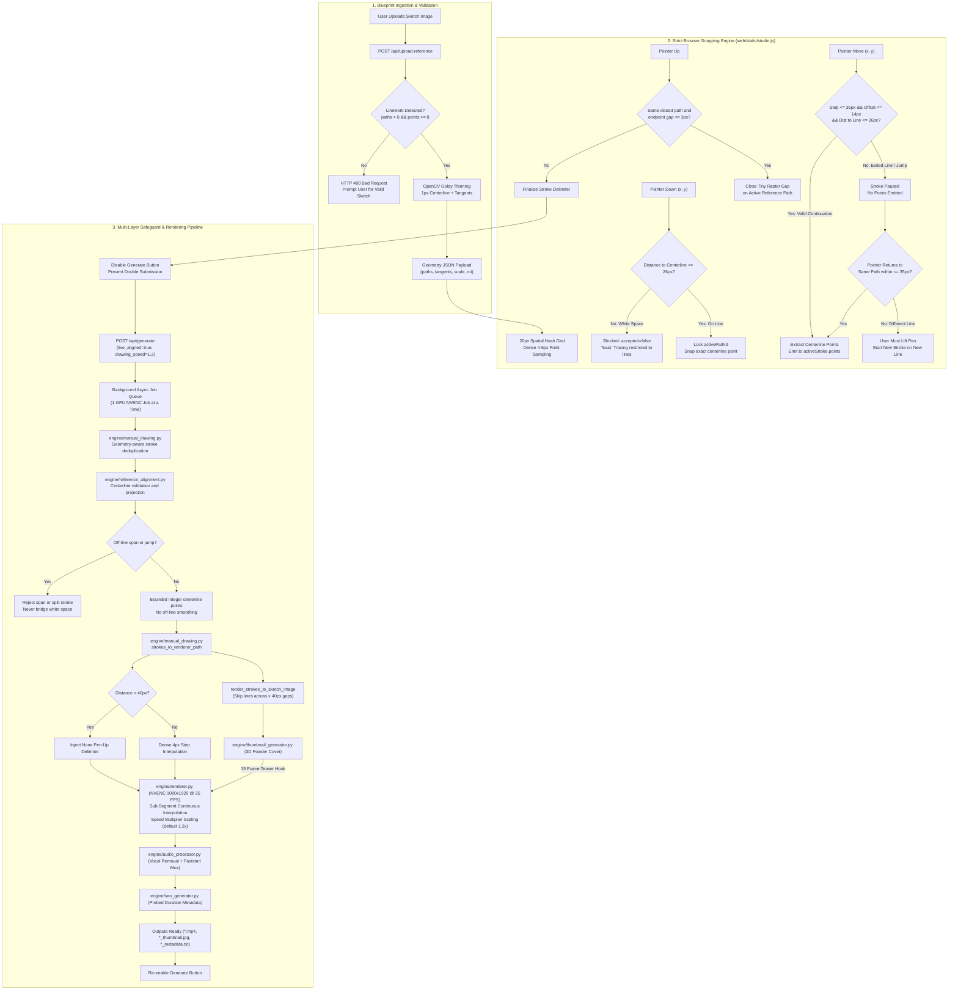

# Headless Kolam Video Generator V2/V3 - AI Agent System Specification & Architecture Reference

> **Document Type:** Master AI Agent Operational & Architectural Specification  
> **Target Audience:** Autonomous AI Coding Agents, Pair Programmers, Multimodal LLMs, and Human Engineers  
> **Current Version:** Version 3.3 (Dual 2D/3D Raised-Powder Video Engine, ComfyUI Bridge & Authentic Flow)  
> **Last Updated:** October 2026  
> **Repository Root:** `D:\kolam video generation v2`

---

## 1. Executive Summary & System Mission

The **Headless Kolam Video Generator V2/V3** is an automated, end-to-end multimedia generative pipeline designed to turn hand-drawn sketches, traditional Kolam patterns, and Rangoli drawings into high-retention, YouTube Shorts-compliant vertical videos (`1080x1920`, `25 FPS`, H.264, vertical 9:16 aspect ratio, duration < 60s).

The system supports two complementary workflows:
1. **Automated Headless CLI Workflow (`generate.py`):** Turn static sketch images into progressively drawn videos with zero manual human intervention, adhering to **100% Authentic Human Drawing Flow**:
   - **Elimination of CNC Parallel Line Hatching:** Continuous strand weaving preserves boundary turnarounds and diagonal corridors, assembling complex Sikku Kolams into 1 to 4 maximal continuous loops rather than 30+ fragmented segments.
   - **Resolution of Reversed Drawing Order:** Center-outward topological stroke partitioning guarantees that the central core intertwining braid is completed before outer boundary petals and decorative crescents are drawn.
   - **Clockwise Polar Flourishes:** Outer embellishments are drawn in smooth clockwise polar succession rather than random spatial hops.
   - **Curvature-Adaptive Motor Dynamics & Airborne Pen Lifts:** Drawing speed adapts to curve curvature ($v(t) = v_{\text{base}} \cdot (1.0 + 0.5(1.0 - \kappa))$), and pen lifts trigger realistic 3D airborne elevation ($-18\text{px}$) with rapid 3-to-5 frame transit.
   - **Dual-Video Synchronous Generation:** Every run automatically creates two complete, independently playable videos sharing the exact same validated geometry and animation timeline: (1) the original authentic 2D video on wood, and (2) a photorealistic 3D raised rice-flour powder video with surface lighting, shadows, and AO.
2. **Strict Blueprint-Only Interactive Tracing Studio Workflow (`web_app.py`):** Web-based tracing studio accessible locally and over Wi-Fi/LAN. Users upload a black-on-white Kolam sketch which acts as an authoritative tracing blueprint. The human determines *WHAT* to draw and the *ORDER/DIRECTION* to trace it; the blueprint geometry strictly dictates *WHERE* the strokes go. Pointerdown in white space is blocked, departures pause without drawing, gap jumps ($> 35\text{px}$) are rejected, and intermediate curve points are locked directly onto the extracted 1px centerline skeleton. Generated outputs are presented with dual-tab viewing (`Original 2D Video` / `3D Enhanced Video`).

### Core Generative & Rendering Subsystems
1. **Multimodal Structural Decomposition** (Local Vision LLM via Ollama dynamically prioritizing `qwen2.5-vl`, `llama3.2-vision`, and `llava:7b` with 60s timeout, generating structural JSON hierarchies of symmetry, braid continuity, and drawing stages).
2. **Dot Extraction & Separation** (Connected-component circularity filtering $A \in [35, 1000]$, $\ge 0.40$, 6px dilation masking to prevent line-dot fusion, and row-by-row sorting for Phase 1 tapping).
3. **Topological Continuous-Strand Stitcher** (Pixel adjacency graph walker routing diagonal corridors through boundary loops/turnarounds, assembling 1 to 4 maximal loops for Sikku Kolams without CNC hatching).
4. **Strict 3-Phase Centroid-Outward Stroke Sorting** (Phase 1: Dot grid taps, Phase 2: Central core intertwining weave, Phase 3: Clockwise polar-ordered outer flourishes $\theta$).
5. **Greedy Nearest-Neighbor Pen Transitions** (Distance-minimizing stroke chaining with automatic path reversal and single `None` airborne pen-up delimiters).
6. **Continuous Spline Smoothing** (Equidistant arc-length resampling at $ds = 3.0\text{px}$ with 1D Gaussian filtering $\sigma = 1.2$, eliminating raster staircasing).
7. **Curvature-Adaptive Dynamic Motor Velocity & Shorts Duration Compliance** (Rendering duration bounded to **40 to 52 seconds**, rhythmic dot tapping at ~0.08s/dot, and curvature-dependent velocity scaling).
8. **3D Airborne Pen-Lift Physics** (Hand sprite vertical elevation by $-18\text{px}$ on `None` delimiters with 3-to-5 frame transit and soft ease-landing).
9. **Hardware-Accelerated Frame Compositing** (NVIDIA NVENC H.264 rendering with realistic pen/hand overlay, wooden background, and animated branding badges).
10. **Sub-Segment Continuous Interpolation Engine** (Smooth, natural hand-drawing animation allocating frames proportionally to stroke arc length, eliminating stepping artifacts, zero-length segments, or redundant stroke redraws).
11. **Procedural Auspicious Coloring Thumbnail Generation** (Connected-component color filling, 3D powder depth distance transforms, drop shadows, and high-CTR badges).
12. **Acoustic Vocal-Removed BGM Processing** (Center-channel vocal attenuation with punchy low-frequency bass preservation, looped seamlessly, muxed via FFmpeg with `-movflags +faststart` for instant web/mobile streaming).
13. **Dynamic Bilingual SEO & Metadata Engine** (Tamil + English click-worthy titles, descriptions, and motif-aware tags).
14. **YouTube Data API v3 Automated Publishing** (Direct OAuth2 upload with custom thumbnail attachment and automated categorization).
15. **Strict Blueprint Tracing Studio & Snap Engine** (Lightweight Flask backend, responsive HTML5/Canvas frontend, OpenCV morphological skeleton extraction, 20px spatial hash index, sub-millisecond centerline locking, multi-tier gap prevention, generation button locking, and real-time generation polling).
16. **Production Lifecycle Management** (`start.bat` & `stop.bat` with dual-stack IPv4/IPv6 discovery, port collision detection, configurable speed multiplier, and safe PowerShell CIM process inspection preventing termination of non-Kolam processes).
17. **3D Raised-Powder Video Rendering Engine (`engine/renderer_3d.py`)** (Deterministic height-field generation via distance transforms, Sobel normal maps, directional illumination, specular highlights, contact shadows, ambient occlusion, and temporally stable static powder grain).
18. **ComfyUI Integration Bridge & Robust Fallback (`engine/comfyui_bridge.py`)** (Filesystem auto-discovery across `D:\AI Youtub\ComfyUI` and default paths, active REST API health check, SD checkpoint cataloging, and seamless deterministic fallback if offline).
19. **Loop Overshoot Trimmer & Hand Tremor Deduplication (`engine/manual_drawing.py`)** (Human loop-closure re-tracing trimmed within 10–35% arc overshoot, spatial hash indexing at 3.0px tolerance, and removal of zero-length fragments and duplicate pen-up delimiters).

---

## 2. Host System & Hardware Specifications

All AI agents executing, profiling, or debugging code on this system must account for the following host hardware environment and operating system constraints:

### 2.1 Hardware Architecture
| Component | Specification | Details / Agent Implications |
| :--- | :--- | :--- |
| **Operating System** | **Microsoft Windows 11 Pro 64-bit** | Version: `10.0.26300`, Build: `26300` (Release 2026) |
| **CPU** | **AMD Ryzen 5 5600X 6-Core Processor** | 6 Physical Cores, 12 Logical Processors (~3.70 GHz base, boost up to 4.6 GHz, 32 MB L3 Cache) |
| **Motherboard** | **Gigabyte Technology Co., Ltd. B550M DS3H AC** | AMD B550 Chipset, PCIe 4.0, Dual M.2 slots |
| **System Memory (RAM)** | **32 GB DDR4 (Dual-Channel)** | 2x 16 GB G.Skill Ripjaws V (`F4-3200C16-16GVK`), Configured Clock: `3200 MHz`, Total Visible: ~33.45 GB (`33,452,504 KB`), Available: > 22 GB |
| **Dedicated GPU** | **NVIDIA GeForce RTX 3060 Ti** | 8 GB GDDR6 (`8,192 MiB` VRAM), Driver `617.42` / `32.0.16.1742`, WDDM Driver Model, PCIe Bus `07:00.0`, 200W TGP |
| **CUDA Runtime** | **CUDA 13.4 UMD / PyTorch cu130** | Supports PyTorch `2.9.1+cu130`, CUDA 13.0, cuDNN `91200` (`torch.cuda.is_available() == True`) |
| **Video Hardware Encoder** | **NVIDIA NVENC (Ampere 7th Gen)** | Target codec: `h264_nvenc`, Preset: `p6`, Bitrate: `8M`, Pixel Format: `yuv420p` |
| **Primary Storage (OS Drive C:)** | **Samsung SSD 980 500GB** | NVMe PCIe 3.0 M.2 SSD (~465 GB NTFS) |
| **Secondary Storage (Work Drive D:)** | **Samsung SSD 980 1TB** | NVMe PCIe 3.0 M.2 SSD (~931.5 GB NTFS, dedicated workspace & media repository `D:\kolam video generation v2`, `D:\ncs music`) |
| **Wireless Networking** | **Intel Dual Band Wireless-AC 3168** | Wi-Fi 5 (802.11ac), Link Speed: ~325 Mbps, LAN IPv4/IPv6 dual-stack connectivity |
| **Wired Networking** | **Realtek Gaming GbE Family Controller** | Gigabit Ethernet (10/100/1000 Mbps) |

### 2.2 Software & Toolchain Specifications
| Tool / Environment | Version / Configuration | Agent Operational Notes |
| :--- | :--- | :--- |
| **Python Runtime** | `Python 3.10.6 (64-bit)` | `tags/v3.10.6:9c7b4bd`, MSC v.1932 AMD64 in standard PATH (`python.exe`) |
| **FFmpeg Binary** | `FFmpeg 7.1-full_build-www.gyan.dev` | Built with GCC 14.2.0 (MSYS2). Full NVENC (`h264_nvenc`, `hevc_nvenc`, `av1_nvenc`), ffprobe, and complex filter graph support |
| **OpenCV** | `4.8.1` (`cv2`) | Native SIMD acceleration for contour detection, dilation, distanceTransform, and Golay skeletonization |
| **Scikit-Image** | `0.24.0+` (`skimage`) | Topological skeletonization (`skimage.morphology.skeletonize`) for continuous strand weaving |
| **PyTorch Ecosystem** | `torch 2.9.1+cu130` | GPU acceleration active with CUDA 13.0 and cuDNN 9.1.2 |
| **Pillow (PIL)** | `10.4.0` | Font rendering (`arialbd.ttf`, `seguiemj.ttf` for emojis and badges) |
| **Flask** | `3.1.3` | Lightweight WSGI web framework powering Drawing Studio REST API |
| **NumPy** | `1.26.4` | Matrix computations, coordinate transformations, and polar binning |
| **Node.js Runtime** | `v24.12.0` (npm `11.5.2`) | Runs browser snapping regression test suite (`tests/test_browser_snapping.js`) in headless V8 engine |
| **Local Vision LLM (Optional)** | `Ollama` (`qwen2.5-vl`, `llama3.2-vision`, `llava:7b`) | Client version `0.40.4`. REST endpoint: `http://localhost:11434/api/generate`. Dynamic tag discovery with 60s timeout |
| **Google APIs** | `google-api-python-client`, `google-auth-oauthlib` | YouTube Data API v3 OAuth 2.0 integration |
| **Music Library** | `D:\ncs music` | Contains royalty-free audio tracks (`.mp3`, `.wav`, `.m4a`) |

### 2.3 Windows Platform Specifics Handled in Code
1. **Native IPv6 & Dual-Stack Networking:** Full IPv6 connectivity is active on the host system. Standard Python dual-stack socket resolution functions natively without artificial IPv4 overrides.
2. **Tamil Unicode Output Encoding:** To prevent Windows console crashes (`cp1252` encoding errors) when printing Tamil characters (e.g., `ரங்கோலி கோலம்`), `sys.stdout` and `sys.stderr` are reconfigured to `utf-8` with `errors="replace"`.
3. **Piping via Subprocess to FFmpeg:** Video frames are streamed via standard input (`stdin.write(frame.tobytes())`) into a persistent FFmpeg NVENC process to avoid disk I/O bottlenecks.
4. **MP4 Faststart Flag:** All generated and audio-muxed videos include `-movflags +faststart` to move the `moov` atom to the beginning of the container, enabling instantaneous buffer streaming on LAN browsers and mobile devices.

---

## 3. Repository Directory Structure

```text
D:\kolam video generation v2\
│
├── generate.py                     # [CLI Entrypoint] Automated image-to-video orchestrator (with --drawing-speed)
├── web_app.py                      # [Web Entrypoint] Interactive Drawing Studio server & REST API
├── upload_to_youtube.py            # [CLI Tool] Standalone YouTube Shorts uploader
├── requirements.txt                # Core Python package dependencies (Flask, OpenCV, etc.)
├── README.md                       # High-level project documentation
├── AI_SYSTEM_DOC.md                # [This File] Master specification for AI agents
│
├── generate.bat                    # One-click batch runner (drag-and-drop input image)
├── start.bat                       # Automated server launcher (LAN discovery, port check, --speed, auto-browser)
├── stop.bat                        # Graceful server shutdown & safe PowerShell process validation
├── start_drawing_studio.bat        # Convenience launcher for Drawing Studio
├── upload_to_youtube.bat           # One-click batch uploader for latest outputs
├── reset_youtube_account.bat       # Token flush script to switch Google accounts
│
├── client_secrets.json             # Google Cloud OAuth 2.0 Client credentials (Secret)
├── client_secrets.json.example     # Template for Google OAuth setup
├── youtube_token.pickle            # Cached OAuth access & refresh token session
├── server.pid                      # Records active PID and Port of background studio server
│
├── engine/                         # Core algorithm & processing modules
│   ├── classifier.py               # Visual classification (Ollama LLaVA + CV heuristics)
│   ├── dot_generator.py            # Mathematical dot matrix & pulli grid generator
│   ├── path_generator.py           # Dot-grid paths & centerline/contour sketch tracing
│   ├── manual_drawing.py           # Vector stroke deduplication, normalization & sketch synthesis
│   ├── reference_alignment.py      # Reference-guided stroke correction & Viterbi path alignment
│   ├── renderer.py                 # NVENC-first frame renderer, arc-length timing & speed scaling
│   ├── renderer_3d.py              # Photorealistic 3D raised rice-flour powder engine (normals, lights, shadows, AO)
│   ├── comfyui_bridge.py           # ComfyUI discovery, server health, checkpoint cataloging & deterministic fallback
│   ├── thumbnail_generator.py      # Auspicious color filling, 3D powder & cover generator
│   ├── audio_processor.py          # Acoustic vocal removal, DSP filter graph & faststart audio muxer
│   ├── seo_generator.py            # Visual motif analysis & Tamil-English SEO generator
│   ├── youtube_uploader.py         # YouTube Data API v3 uploader & metadata sync
│   └── assets/                     # Core static visual assets
│       ├── hand_raw.png            # Transparent hand sprite holding pen
│       ├── hand_raw22.png          # High-resolution alternative hand sprite
│       ├── wood.jpg                # 1080x1920 realistic wood background texture
│       └── wood1.jpg               # Alternative wood surface texture
│
├── web/                            # Interactive Drawing Studio Web Frontend
│   ├── templates/                  # Jinja2 HTML templates
│   │   └── studio.html             # Responsive 9:16 drawing studio with dual-video tabs (2D / 3D)
│   └── static/                     # Frontend static assets
│       ├── studio.css              # Dark-mode styling, responsive multi-breakpoint layout & touch protection
│       └── studio.js               # Strict blueprint snapper, deduplicated recorder, dual-video player & API polling
│
├── inputs/                         # Input sketches and reference materials
│   ├── uploads/                    # Reference images uploaded via Drawing Studio
│   ├── 77d59084...-sketch (1).jpg  # Sample input sketch
│   └── reference.mp4               # Golden reference target video
│
├── tests/                          # Automated unit and integration tests (see current test table below)
│   ├── test_smooth_rendering_and_speed.py # Arc-length timing, dedupe, frame progression & audio tests
│   ├── test_manual_drawing.py      # Payload normalization, pen-up signals & sketch synthesis
│   ├── test_web_api.py             # Flask endpoints, job submission & reference uploads
│   ├── test_reference_alignment.py # Skeleton extraction, geometry matching & alignment
│   ├── test_end_to_end_alignment_render.py # Reference alignment to NVENC video render
│   ├── test_live_snapping.py       # Geometry serialization & strict live-path validation
│   ├── test_path_generator.py      # Thick-line centerline tracing regression
│   ├── test_browser_snapping.js    # Node.js ReferenceSnapper tests
│   └── test_dual_and_3d_rendering.py # 3D raised powder, frame count parity, overshoot trimming & ComfyUI fallback
│
└── outputs/                        # Generated output artifacts (*.mp4, *_3d.mp4, *_thumbnail.jpg, *_metadata.txt)
```

---

## 4. End-to-End Pipeline Workflows

### 4.1 Automated Headless CLI Workflow (`generate.py`)

The automated execution flow turns an existing sketch image into an authentically drawn video via 8 sequential phases:

```mermaid
flowchart TD
    A["Input Sketch (Image File)"] --> B["Phase 1: Classifier (engine/classifier.py)<br/>Multimodal Structural Decomposition<br/>(qwen2.5-vl / llama3.2-vision / llava:7b)"]
    B -->|Type, Grid & Structure JSON| C["Phase 2: Dot Extraction & Grid Generation<br/>(engine/dot_generator.py & CV Circularity Filter)"]
    B -->|Structural Hierarchy| D["Phase 3: Path Generator (engine/path_generator.py)<br/>Topological Continuous-Strand Stitcher<br/>3-Phase Centroid-Outward Sorting"]
    C -->|Dot Coordinates & Row Order| D
    
    D -->|2D Traversal Vector| E["Phase 4: Thumbnail Generator (engine/thumbnail_generator.py)"]
    C -->|Dot Coordinates| E
    E -->|Teaser Cover Image (1080x1920)| F["Phase 5: Renderer Engine (engine/renderer.py)<br/>Curvature-Adaptive Velocity (40-52s Shorts)<br/>3D Airborne Pen-Lifts (-18px elevation)<br/>NVENC H.264 @ 25 FPS"]
    
    D -->|Coordinate Trajectory| F
    C -->|Dot Positions| F
    F -->|Raw Video (1080x1920, 25 FPS, Sub-Segment Smooth)| G["Phase 6: Audio Processor (engine/audio_processor.py)"]
    
    G -->|Faststart Muxed Video with Vocal-Removed BGM| H["Phase 7: Dynamic SEO Engine (engine/seo_generator.py)"]
    H -->|Metadata File (*_metadata.txt)| I{"User / CLI Upload Flag"}
    
    I -->|--upload or Interactive Yes| J["Phase 8: YouTube Uploader (engine/youtube_uploader.py)"]
    I -->|--no-upload or Skipped| K["Finished: Ready in outputs/"]
```

#### Execution Order Guarantees for 100% Authentic Human Flow:
1. **Phase 1: Dot Grid Placement:** If dots are present, all dots are placed first as rapid, rhythmic stamps (~0.08s per dot) in natural top-to-bottom, row-by-row sequence.
2. **Phase 2: Core Intertwining Weave:** The central braid and core body are traced continuously from the center of mass outward. Turnaround loops at grid margins are routed back into returning diagonal corridors, preserving 1 to 4 maximal continuous loops and eliminating CNC-style parallel hatching.
3. **Phase 3: Clockwise Outer Flourishes:** Outer boundary petals, crescents, and corner motifs are drawn strictly *after* the core pattern, organized in smooth clockwise polar order ($\theta = (\operatorname{atan2}(y-C_y, x-C_x) + \pi/2) \pmod{2\pi}$). Outer petals are never drawn before the core.
4. **Airborne Transitions:** Airborne pen-up repositioning elevates the hand sprite by $-18\text{px}$ in 3 to 5 frames, moving to the nearest stroke start via greedy nearest-neighbor chaining with automatic path reversal.

### 4.2 Strict Blueprint Tracing Studio Workflow (`web_app.py`)

The strict blueprint tracing workflow enforces that all accepted strokes remain constrained to the extracted 1px centerline geometry of the uploaded blueprint image. Raw white-area drawing is strictly blocked, and moving across gaps pauses tracing rather than drawing connecting lines:



---

## 5. Subsystem Deep-Dive & Module Specifications

### 5.1 CLI Orchestrator (`generate.py`)
- **Primary Function:** Parses command-line arguments, auto-discovers inputs in `inputs/`, executes phases 1 through 8 in sequential lockstep, and logs structured progress.
- **Key CLI Arguments:**
  - `--input`, `-i`: Path to the input sketch image. If omitted, auto-selects the first `.jpg`/`.png` in `inputs/`.
  - `--output`, `-o`: Target `.mp4` file path (defaults to dynamic `outputs/<basename>_<timestamp>.mp4`).
  - `--type`, `-t`: Kolam classification (`auto`, `pulli_kolam`, `sikku_kolam`, `rangoli`, `mandala`).
  - `--grid`, `-g`: Dot grid format (`8x2`, `6x2`, `none`).
  - `--fps`: Target frames per second (default: `25`).
  - `--drawing-speed`: Float drawing speed multiplier (default: `1.2`). Higher values accelerate hand animation; lower values produce deliberate, relaxed drawing.
  - `--no-hand`: Boolean switch to disable the hand/pen overlay.
  - `--no-watermark`: Disables footer watermark badge (`LIKE | SHARE | SUBSCRIBE`).
  - `--no-thumbnail`: Disables procedural colored thumbnail generation.
  - `--music-dir`: Path to background music directory (default: `D:\ncs music`).
  - `--no-music`: Skips audio processing and muxing.
  - `--music-volume`: Float volume multiplier (default: `1.3`).
  - `--title`: Channel / Series title displayed on badges (default: `AK Kolam`).
  - `--upload`: Automatically uploads to YouTube without prompting.
  - `--no-upload`: Completely skips YouTube upload prompt.
  - `--privacy`: Upload privacy state (`public`, `unlisted`, `private`).

---

### 5.2 Vision Classification (`engine/classifier.py`)
- **Module Purpose:** Detects whether an input drawing is a dot-based Kolam or a continuous contour Rangoli/Mandala, infers the grid size, and decomposes the artwork into a multimodal structural hierarchy.
- **Layer 1: Multimodal Structural Decomposition (`classify_kolam_local_llm`)**
  - **Dynamic Vision Model Auto-Detection:** Queries `http://localhost:11434/api/tags` and automatically selects the highest capability vision model available, prioritizing:
    1. `qwen2.5-vl` (Top priority for high-resolution visual grounding)
    2. `llama3.2-vision` (Fast, high-accuracy multimodal reasoning)
    3. `llava:7b` (Robust baseline multimodal vision)
  - **Extended Inference Timeout:** Configured with `timeout=60` to ensure local vision LLMs complete full high-resolution image analysis without premature timeout aborts.
  - **Enforced Structural Hierarchy Schema:** Sends a Base64-encoded payload enforcing a strict structural decomposition system prompt:
    ```json
    {
      "kolam_type": "sikku_braid | pulli_grid | freehand_rangoli | mandala_radial",
      "has_dots": true,
      "symmetry": "4_fold_rotational | bilateral_mirror | radial_concentric",
      "drawing_order": [
        "step_1_dot_grid",
        "step_2_central_core_body",
        "step_3_connecting_interlaces",
        "step_4_outer_embellishments"
      ],
      "braid_continuity": "continuous_loop",
      "dot_count_estimate": 57
    }
    ```
  - **Structural Result Exposure:** Exposes the parsed structural dictionary in `classification_result["structure"]` alongside traditional fields (`type`, `dot_grid`, `confidence`), guiding subsequent path generation and stroke ordering.
- **Layer 2: Deterministic Heuristic Fallback (`classify_heuristic`)**
  - If Ollama is offline or times out, triggers CV-based heuristics:
    1. **Color Saturation:** Calculates mean HSV saturation (`np.mean(hsv[:,:,1])`). If `mean_sat > 60` and large contours exist, classified as `rangoli`.
    2. **Dot Blob Counting:** Inverts grayscale image and finds contours with area $5 < \text{area} < 200$. If `count >= 20`, classified as `sikku_kolam` with `8x2` grid.
    3. **Circular Symmetry:** If large contours exist without dot clusters, classified as `mandala`.
    4. **Default Fallback:** `pulli_kolam` with `8x2` grid.

---

### 5.3 Geometric Dot Grid Generator (`engine/dot_generator.py`)
- **Module Purpose:** Computes precise pixel coordinates $(x, y)$ for the traditional dot grid on a $1080 \times 1920$ canvas.
- **Grid Modes:**
  - `8x2` Diamond Grid: 40 total dots configured in rows of `[2, 4, 6, 8, 8, 6, 4, 2]`. Horizontal and vertical spacing: $110\text{ px}$. Top offset: $Y = 480$.
  - `6x2` Diamond Grid: Rows of `[2, 4, 6, 6, 4, 2]`. Spacing: $120\text{ px}$, Top offset: $Y = 550$.
  - `none`: Returns an empty list `[]` for freehand Rangoli or circular Mandalas.

---

### 5.4 Stroke Vectorization & Path Generator (`engine/path_generator.py`)
- **Module Purpose:** Converts discrete dot grids or sketch images into an ordered, continuous trajectory of 2D coordinates representing 100% authentic human drawing flow.
- **Stroke Delimiter Protocol:** Uses Python `None` entries in the path list as a **Pen-Up Signal**. When the pen encounters `None`, it lifts and moves to the next coordinate without drawing a connecting line.
- **Topological Continuous-Strand Stitcher & Authentic Drawing Flow:**
  1. **Dot Extraction & Separation:**
     - **Circularity Filtering:** Detects dot centroids via connected-component analysis on the inverted binary image with area $A \in [35, 1000]$ and circularity $\frac{4\pi A}{P^2} \ge 0.40$.
     - **6px Dilation Masking:** Dilates extracted dot regions by $6\text{px}$ and subtracts them from the line-art mask before skeletonization. This prevents line ink from fusing into dots, ensuring clean corridor topology.
     - **Row-Wise Sorting:** Sorts dot coordinates top-to-bottom, row-by-row for Phase 1 sequential rhythmic tapping.
  2. **Skeleton Graph & Boundary Turnaround Stitching (Eliminating CNC Parallel Hatching):**
     - Skeletonizes the masked line ink using `skimage.morphology.skeletonize`.
     - Builds an undirected pixel adjacency graph classifying vertices into junctions (`degree >= 3`), regular corridor points (`degree == 2`), and dead ends (`degree == 1`).
     - **Crucial Boundary Turnaround Rule:** When tracing along diagonal corridors, when a strand reaches a boundary loop/turnaround at the diamond grid margin, **the path does not terminate**. It traces through the outer boundary loop and continues smoothly along the returning diagonal corridor.
     - Assembles lines into **maximal continuous closed or open loops**. For Sikku Kolams, the entire central pattern resolves into **1 to 4 long continuous paths** rather than 30+ tiny segments, completely eliminating CNC-style parallel line hatching.
  3. **Strict Centroid-Outward Stroke Sorting (Fixing Reversed Drawing Order):**
     - Computes the image center of mass $(C_x, C_y)$.
     - Measures mean radius $R_i = \text{mean}(\sqrt{(x - C_x)^2 + (y - C_y)^2})$ for each continuous path.
     - Categorizes paths into:
       * `core_paths`: Paths with low to medium radius (the central intertwining braid and core body).
       * `outer_flourishes`: Paths with high radius (boundary petals, crescents, corner motifs).
     - **Strict 3-Phase Execution Order:**
       * **Phase 1:** Dot grid taps (drawn first).
       * **Phase 2:** `core_paths` drawn completely (center-outward continuous weave).
       * **Phase 3:** `outer_flourishes` drawn strictly last, sorted in smooth clockwise polar succession:
         $$\theta = \left(\operatorname{atan2}(y - C_y, x - C_x) + \frac{\pi}{2}\right) \pmod{2\pi}$$
         This completely prevents outer boundary petals or decorative crescents from drawing before the central core.
  4. **Greedy Nearest-Neighbor Pen Transitions:**
     - Between separate strokes, finds the unvisited path whose endpoint is closest to the current pen tip:
       $$D = \min(\text{dist}(\text{current\_pos}, \text{next\_start}), \text{dist}(\text{current\_pos}, \text{next\_end}))$$
     - If the endpoint is closer than the start, automatically reverses that path and continues forward.
     - Inserts a single `None` delimiter between separate strokes to trigger 3D airborne pen-lift physics.
  5. **Continuous Spline Smoothing:**
     - Equidistantly resamples all paths at $ds = 3.0\text{ px}$.
     - Applies 1D Gaussian filtering ($\sigma = 1.2$, wrapping closed loops) to eliminate raster pixel staircasing while preserving sharp loop apexes.

---

### 5.5 Video Rendering Engine (`engine/renderer.py`)
- **Module Purpose:** Generates individual video frames, applies overlays, animates pen/hand movements, and streams raw frames directly to the hardware video encoder.
- **Motor Dynamics & Sub-Segment Continuous Interpolation:**
  - **YouTube Shorts Duration Compliance (40 to 52 seconds):**
    - The entire drawing animation is scaled so total duration falls strictly between **40 and 52 seconds**, fully compliant with YouTube Shorts' 60-second limit while maximizing viewer retention.
  - **Rhythmic Dot Placement Dynamics:**
    - Dot grid placement uses rapid, rhythmic stamps (~0.08s per dot, ~4.5s total across 40–57 dots), giving a crisp, authentic chalk/powder tapping effect.
  - **Curvature-Adaptive Dynamic Velocity:**
    - Line drawing speed dynamically adjusts based on local curve curvature $\kappa$:
      $$v(t) = v_{\text{base}} \cdot (1.0 + 0.5 \cdot (1.0 - \text{clamped\_curvature}))$$
      The hand naturally slows down when navigating tight loops around dots, and fluidly accelerates along straight corridors.
  - **3D Airborne Pen-Lift Physics:**
    - On encountering a `None` pen-up delimiter, the hand sprite is elevated vertically by $-18\text{ px}$ (simulating lifting off the wooden canvas), translates rapidly to the next stroke start in 3 to 5 frames, and gently descends back to the drawing plane before ink flows.
  - **Arc-Length Cumulative Parameterization:** Computes Euclidean segment distances $d_i = \sqrt{\Delta x^2 + \Delta y^2}$ and cumulative arc length $D(s) = \sum d_i$ for each independent stroke.
  - **Arc-Length Frame Allocation:** Drawing time is based on total path distance at about 8.85 logical pixels per frame at speed 1.0, then apportioned across strokes by length with a two-frame minimum. Changing vertex density does not change playback duration.
  - **Speed Multiplier Support (`drawing_speed: float = 1.2`):** A multiplier above 1 increases pixels traveled per frame; a multiplier below 1 increases duration. Pen-up repositioning uses a faster distance-proportional pace with a 2-to-30-frame bound.
  - **Sub-Segment Coordinate Interpolation:** For each animation frame $f$, the engine calculates target distance $D_t = \frac{f+1}{N} \cdot L$. It advances along vertices and linearly interpolates exact intermediate coordinates:
    $$\alpha = \frac{D_t - D_{i-1}}{D_i - D_{i-1}}, \quad P(t) = (1 - \alpha) P_{i-1} + \alpha P_i$$
  - **Zero-Length & Single-Point Handling:** Single-point dots ($L < 10^{-4}\text{px}$) are drawn via `cv2.circle` with exact thickness for $N$ frames, eliminating empty render exceptions.
  - **Monotonic Progress Reporting:** Progress callbacks report monotonically from $0.0\%$ to $100.0\%$ across all animation frames with zero backward resets.
  - **Encoder Lifecycle:** Probes `h264_nvenc` before rendering, streams frames to a temporary MP4, checks the subprocess return code and stderr, then atomically publishes a valid output. Failed NVENC initialization selects FFmpeg `libx264`; OpenCV is the final fallback.
- **Frame Composition Stack (Bottom to Top):**
  1. **Background Layer:** Textured wood background ($1080 \times 1920$).
  2. **Dot Grid Layer:** Anti-aliased white circles ($r=5\text{ px}$, color `#FFFFFF`).
  3. **Progressive Stroke Layer:** Anti-aliased white line segments ($6\text{ px}$ thickness).
  4. **Animated Pen / Hand Sprite:** Hand image with transparent alpha background, rotated and translated so the pen tip aligns exactly with the current stroke head (with $-18\text{px}$ elevation during airborne pen-up transit).
  5. **Header Pill Badge:** Modern glassmorphism pill displaying `--title` (e.g. `AK Kolam`) with drop shadow and gold outline ($Y=130$).
  6. **Footer Pill Badge:** High-retention subscriber badge (`👍 LIKE | ↗ SHARE | 🔔 SUBSCRIBE`) rendered in the mobile-safe zone ($Y=1730$).
- **Opening Teaser Hook:** Renders 15 frames (~0.6 seconds) of the finished, colorized thumbnail with a 3-frame crossfade into the blank canvas to ensure YouTube Shorts displays an attractive cover.
- **Video Encoding Pipeline:**
  - Primary: FFmpeg subprocess pipe streaming raw BGR24 frames directly to NVIDIA NVENC (`h264_nvenc -preset p6 -b:v 8M -pix_fmt yuv420p -movflags +faststart`).
  - Fallback: `cv2.VideoWriter(..., fourcc='mp4v')` if FFmpeg is unavailable.
- **Holding Period:** Renders 25 additional frames (1.0 second at 25 FPS) of the completed art piece before terminating.

---

### 5.5b 3D Raised-Powder Video Rendering Engine (`engine/renderer_3d.py`)
- **Module Purpose:** Produces a visually realistic secondary video of the Kolam being drawn with raised rice-flour / powder depth on the authentic wooden background. It consumes the exact same validated geometry, stroke ordering, and sub-segment frame timeline as `renderer.py` to guarantee identical temporal progression.
- **Architectural Principles & Deterministic Lighting Pipeline:**
  1. **Strict Geometry Preservation:** Centerlines, loop apexes, and dot grid coordinates remain 100% authoritative. The 3D effect enhances surface materiality without shifting stroke coordinates.
  2. **Deterministic Distance-Field Height Map:**
     - Computes Euclidean distance transform $d(x, y)$ from stroke contours (`cv2.distanceTransform(mask, cv2.DIST_L2, 5)`).
     - Maps distance to a smooth cosine-beveled cross-section:
       $$h(x, y) = h_{\text{max}} \cdot \frac{1 - \cos\left(\pi \cdot \min(1.0, d / r_{\text{bevel}})\right)}{2}$$
       where $h_{\text{max}} = 5.0\text{px}$ and $r_{\text{bevel}} = 3.5\text{px}$, producing gentle, physically plausible powder ridges without ballooning.
  3. **Sobel Normal Gradient Extraction:**
     - Derives partial derivatives via $3\times3$ Sobel filters: $g_x = \frac{\partial h}{\partial x} \cdot 0.25$, $g_y = \frac{\partial h}{\partial y} \cdot 0.25$.
     - Normalizes into 3D unit normal vectors $\mathbf{N} = \frac{(-g_x, -g_y, 1.0)}{\sqrt{g_x^2 + g_y^2 + 1.0}}$.
  4. **Directional Illumination & Specular Glint:**
     - Directional light vector pointing top-left: $\mathbf{L} = (0.35, -0.45, 0.82)$ normalized.
     - Diffuse term: $I_{\text{diffuse}} = 0.55 + 0.45 \cdot \max(0, \mathbf{N} \cdot \mathbf{L})$.
     - Specular highlight: Half-angle vector $\mathbf{H} = \frac{\mathbf{L} + (0, 0, 1)}{\|\mathbf{L} + (0, 0, 1)\|}$, $I_{\text{spec}} = 0.22 \cdot (\max(0, \mathbf{N} \cdot \mathbf{H}))^{18.0}$.
  5. **Soft Contact Shadows & Ambient Occlusion:**
     - Contact shadow shifted along light vector ($+2\text{px}, +3\text{px}$) with Gaussian blur ($\sigma = 1.5$) under the powder ridges.
     - Ambient occlusion factor derived from dilated mask density ($1.0 - 0.20 \cdot \text{AO}$), deepening grooves between closely spaced parallel braids.
  6. **Temporally Stable Static Powder Grain:**
     - Generates a single precomputed static grain texture (`_generate_static_grain(height, width)`) at initialization. Reusing this static map across all frames completely eliminates temporal boiling and noise shimmer.
  7. **Airborne Transitions & Parity with 2D Renderer:**
     - Features identical 3D airborne pen-up elevation ($-18\text{px}$) and transition ease curves.
     - Final hold sequence matches the 2D renderer frame-for-frame (8 frames holding hand, then lift away), guaranteeing exact frame count parity (`frames_2d == frames_3d`).

---

### 5.5c ComfyUI Integration Bridge & Offline Fallback (`engine/comfyui_bridge.py`)
- **Module Purpose:** Integrates local generative AI capabilities for advanced material stylization while protecting pipeline reliability through automated filesystem discovery, health probing, and seamless deterministic fallback.
- **Key Capabilities & Architectural Safeguards:**
  1. **Filesystem Auto-Discovery:** Scans standard paths including `D:\AI Youtub\ComfyUI`, `%LOCALAPPDATA%\ComfyUI`, and environment variables (`COMFYUI_PATH`, `COMFYUI_URL`).
  2. **Active Server Health Probing:** Queries `http://127.0.0.1:8188/system_stats` with a 2.0s non-blocking timeout to ascertain whether the REST API is responsive.
  3. **Model & Checkpoint Cataloging:** Inspects `models/checkpoints` for available Stable Diffusion weights (e.g., `CyberRealistic_V5_FP16.safetensors`, `DreamShaper_8_pruned.safetensors`, `epicrealism_naturalSinRC1VAE.safetensors`) and custom nodes (`ComfyUI-AnimateDiff-Evolved`, `ComfyUI-VideoHelperSuite`).
  4. **Strict Deterministic Fallback:** If ComfyUI is uninstalled, server is stopped, or an inference request times out, the bridge seamlessly reports `deterministic_local` mode. The dual-video pipeline never crashes or halts; it immediately renders using the high-performance local 3D engine (`engine/renderer_3d.py`).
  5. **Non-Destructive AI Conditioning:** When an active workflow is run, it enforces geometry-derived masks and depth maps as hard constraints. Unconstrained text-to-video generation is strictly prohibited to prevent line drift, stroke hallucination, or structural corruption of traditional Kolams.

---

### 5.6 Auspicious Color Thumbnail Engine (`engine/thumbnail_generator.py`)
- **Module Purpose:** Transforms black-and-white input sketches into vibrantly colored, high-click-through-rate (CTR) YouTube Shorts thumbnails ($1080 \times 1920$, 9:16).
- **Core Algorithms:**
  1. **Polar Cell Segmentation:** Morphologically closes sketch lines, inverts the binary image, and segments enclosed regions via `cv2.connectedComponentsWithStats`.
  2. **Traditional Indian Color Harmonization:** Maps concentric rings and alternating sectors to a curated traditional Indian palette:
     - Kumkum Crimson Red (`#E41C2A`)
     - Turmeric Gold Yellow (`#FFDA1C`)
     - Saffron / Marigold Orange (`#FF841E`)
     - Lotus Pink / Magenta (`#F837B9`)
     - Peacock Royal Blue (`#127ADA`)
     - Parrot / Lime Green (`#30C341`)
  3. **3D Powder Depth & Texture:** Applies a distance transform (`cv2.distanceTransform(cells, cv2.DIST_L2, 3)`) combined with Gaussian noise to give the impression of physical, raised Rangoli powder piles.
  4. **White Flour Ridge Outlines:** Overlays crisp white rice-flour boundaries over all segment borders.
  5. **Banner & Badge Composition:** Overlays frosted glass category banners (`SIKKU KOLAM | 8x2`, `MANDALA KOLAM DESIGN`), gold-bordered title pills, and mobile-safe footer branding.

---

### 5.7 Audio Processing Engine (`engine/audio_processor.py`)
- **Module Purpose:** Adds background music while eliminating distracting lyrics or speech, and outputs streaming-optimized MP4 files.
- **Vocal-Removal Acoustic Filter Graph:**
  Implements an active center-channel phase cancellation filter with bass preservation:
  ```text
  [1:a] asplit=2 [b][m];
  [b] lowpass=f=180 [bass];
  [m] highpass=f=180, pan=stereo|c0=c0-c1|c1=c1-c0 [mid];
  [bass][mid] amix=inputs=2, volume=1.3, afade=t=in:ss=0:d=1, afade=t=out:st=<end-2>:d=2 [aout]
  ```
  - **Bass Route (`< 180 Hz`):** Isolates kick drums and basslines in mono, preventing low-end phase cancellation.
  - **Mid/High Route (`> 180 Hz`):** Applies $L - R$ and $R - L$ center-channel cancellation to strip lead vocals.
  - **Recombination & Dynamics:** Mixes bass and stereo instrumental, applies smooth 1-second fade-in and 2-second fade-out matching video duration.
- **Audio Looping:** Uses `-stream_loop -1` so shorter tracks loop seamlessly across longer video renders.
- **Stream Copy & Faststart:** Uses `-c:v copy` and `-movflags +faststart` to mux audio into video losslessly in $<0.5$ seconds without re-encoding video frames while placing container metadata at file start for instant LAN playback.

---

### 5.8 Dynamic Bilingual SEO Engine (`engine/seo_generator.py`)
- **Module Purpose:** Generates high-CTR, non-generic YouTube metadata strictly respecting platform character limits.
- **Motif Detection:** Analyzes contour geometry, aspect ratios, convexity hulls, and polar FFT symmetry to classify motifs into: `sikku`, `pulli`, `lotus`, `bell`, `flower`, `mandala`, or `rangoli`.
- **Title Construction:** Creates bilingual titles under YouTube's strict 100-character limit:
  - Format: `<Channel> | <Tamil Title> | <English Title> #shorts`
  - Example: `AK Kolam | அழகான ரங்கோலி கோலம் 🌸 | Easy Rangoli Design #shorts`
- **Metadata Serialization:** Writes a structured `*_metadata.txt` file alongside the output video, containing:
  - Exact target video path
  - Thumbnail path
  - Click-worthy title
  - Formatted description with chapter tags and timestamps
  - Comma-separated YouTube search tags (< 450 characters total)

---

### 5.9 YouTube Data API v3 Publisher (`engine/youtube_uploader.py` & `upload_to_youtube.py`)
- **Module Purpose:** Uploads video and attaches custom thumbnails to YouTube.
- **Authentication Lifecycle:**
  1. Checks for cached token in `youtube_token.pickle`.
  2. If expired, attempts refresh using refresh token.
  3. If missing, looks for `client_secrets.json`, launches local OAuth server (`port=0`), and prompts user via browser.
  4. Saves token to `youtube_token.pickle` for completely headless subsequent runs.
- **YouTube Studio Parameter Standardization:**
  - `categoryId`: `"26"` (Howto & Style - standard for arts and crafts)
  - `selfDeclaredMadeForKids`: `False` (Not Made for Kids)
  - `containsSyntheticMedia`: `False` (Traditional art creation)
  - `embeddable`: `True`
  - `license`: `"youtube"` (Standard YouTube License)
  - `privacyStatus`: `public` (or overridden via CLI)
  - `defaultLanguage`: `"ta"` (Tamil)
- **Custom Thumbnail Attachment:** Automatically uploads `*_thumbnail.jpg` via `youtube.thumbnails().set(videoId=..., media_body=...)`.

---

### 5.10 Automation Batch Scripts
- `generate.bat`: Windows drag-and-drop interface. Allows dropping any image directly onto the batch file to initiate generation.
- `start_drawing_studio.bat`: Convenience launcher for Drawing Studio. Discovers host LAN IP and launches `start.bat`.
- `upload_to_youtube.bat`: Automatically scans `outputs/` for the most recent metadata or `.mp4` file and initiates upload.
- `reset_youtube_account.bat`: Clears `youtube_token.pickle` to force re-authentication with a different Google account.

---

### 5.11 Interactive Drawing Studio Server (`web_app.py`)
- **Module Purpose:** Provides a LAN-accessible Flask REST API and job worker for interactive drawing, reference sketch upload, and background rendering.
- **Network Binding:** Binds to `0.0.0.0:<port>` (default 8000) for local and Wi-Fi access. Automatically resolves the primary LAN IPv4 address (e.g. `192.168.1.10`) via UDP socket probing and prints local and network access links.
- **Asynchronous GPU Job Worker:** Manages an in-memory job queue with a dedicated worker thread (`worker_thread`), ensuring only one GPU NVENC rendering job executes at any given time to protect VRAM.
- **Drawing Speed Support:** Accepts `drawing_speed` in generation payloads (default: `1.2`) and passes it directly to `render_kolam_video`.
- **Duration Probing:** Uses `get_video_duration(video_path)` to probe exact rendered video duration before generating SEO timestamps.
- **REST Endpoints:**
  - `GET /` — Serves the interactive drawing studio HTML.
  - `GET /api/system-info` — Returns network address, port, and online status.
  - `POST /api/upload-reference` — Validates and stores reference images in `inputs/uploads/`. Extracts and returns precomputed `geometry` JSON payload (paths, tangents, scale, ROI) for immediate client-side spatial grid construction. **Strict Blueprint Validation:** Requires detectable black linework (`len(paths) > 0` and `len(skel_points) >= 8`). Rejects blank or unrecognizable images with HTTP 400.
  - `GET /api/uploads/<filename>` — Serves uploaded reference images safely.
  - `POST /api/generate` — Validates drawing strokes, clamps coordinates, and enqueues video rendering with button locking. Any reference-backed blueprint job is checked against the backend skeleton even when the client says it was live-snapped.
  - `GET /api/jobs/<job_id>` — Returns real-time stage, progress percentage (0-100%), and artifact URLs.
  - `GET /api/jobs/<job_id>/video` — Streams rendered MP4 video with `Accept-Ranges` byte-range support.
  - `GET /api/jobs/<job_id>/thumbnail` — Streams generated YouTube Short thumbnail.

---

### 5.12 Manual Drawing Vector Synthesis (`engine/manual_drawing.py`)
- **Module Purpose:** Validates client-submitted vector stroke data, clamps coordinates to $0 \le x < 1080$ and $0 \le y < 1920$, filters duplicates, and synthesizes renderer-compatible ordered paths.
- **Multi-Level Stroke Deduplication:**
  1. **Stroke ID Deduplication:** Rejects duplicate stroke objects with identical non-empty IDs within a payload.
  2. **Direction-Independent Geometry Deduplication:** Uses coordinate-only signatures and a spatial hash of resampled centerlines to recognize reversed paths and small coordinate noise.
  3. **Partial-Overlap Trimming:** Removes long, direction-consistent intervals already covered by earlier strokes while retaining point intersections, loops, and neighboring lines.
- **Zero-Length & Step Filtering:** Computes Euclidean distance $\Delta = \sqrt{\Delta x^2 + \Delta y^2}$. Consecutive points with $\Delta < 0.5\text{px}$ are omitted as zero-length noise.
- **Single-Point Dot Expansion:** For isolated taps/dots ($N=1$), adds a micro-segment (`x + 1`) with an artificial time delta so the point renders visibly on canvas and in video.
- **Stroke Delimiter Translation:** Injects `None` pen-up signals between independent strokes so separate artistic strokes are never accidentally connected.
- **Gap Detection & Discontinuous Jump Splitting:** Checks Euclidean distance between successive stroke points. If $\Delta > 40\text{px}$, the engine automatically splits the path with a `None` pen-up delimiter.
- **Dense Path Interpolation:** Steps along user segments (max step 4 px) so quick swipes produce smooth line trajectories.
- **Sketch Image Synthesis (`render_strokes_to_sketch_image`):** Draws vector strokes as crisp black lines on a 1080x1920 white canvas (`temp_sketch.png`). Skips drawing line segments across gaps $> 40\text{px}$.

---

### 5.13 Studio Frontend Interface (`web/`)
- **Module Purpose:** Fully responsive, touch-protected digital drawing canvas running seamlessly across desktop, tablet, and smartphone browsers.
- **Stack:** HTML5, CSS3, Vanilla ES6 JavaScript (zero external node/bundler dependencies).
- **Responsive Multi-Breakpoint Layout:**
  - **Desktop (>1080px):** 290px left sidebar dock, spacious controls, centered 9:16 vertical canvas.
  - **Laptops & Tablets in Landscape (769px - 1080px):** 250px left dock with compact padding.
  - **Tablets in Portrait & Smartphones (<=768px):** Transformed into a bottom horizontal scroll dock (`height: 86px`, `flex-wrap: nowrap`, `overflow-x: auto`) with a custom golden scrollbar.
  - **Small Phones (<=480px):** Scaled badges and icons, optimized margins, and compact button sizing.
  - **Mobile Landscape Mode (`max-height: 520px` & orientation landscape):** Shifts to an ultra-slim 180px left dock.
- **Floating Canvas Quick Controls:**
  - Glassmorphism Undo (`↩️`) and Redo (`↪️`) buttons positioned directly on the top-left canvas viewport for one-tap thumb interaction on mobile devices.
- **Generation Button State Locking:**
  - When the user clicks "Generate Video", `btnGenerate.disabled` is set to `true` immediately, preventing double submissions and race conditions. Re-enabled on job completion, error, or modal dismissal.
- **Strict Blueprint-Only Tracing Engine (`ReferenceSnapper`):**
  - **Non-Negotiable Constraint:** Tracing is strictly constrained to the extracted blueprint centerline geometry. Freehand drawing in white areas is completely prohibited.
  - **Strict Blocking on Pointer Down:** Clicking or touching in white space ($> 26\text{px}$ from centerline) is blocked immediately (`accepted: false, blocked: true`), showing an unobtrusive toast notification: *"⚠️ Tracing restricted to blueprint lines. Click directly on a black line to start tracing."*
  - **Departure & Pause Behavior:** If the pointer leaves permitted line geometry ($> 26\text{px}$ away or steps $> 35\text{px}$), tracing pauses at the last valid centerline point.
  - **Continuity & Gap Jump Prevention:** Moving across white gaps ($> 35\text{px}$ step) or jumping to disconnected lines is rejected. No bridging segments are fabricated.
  - **Closed-Loop Wrap-Around Step Calculation:** For closed loops, step direction accounts for circular index wrapping (`wrapDist < directDist`) to select the shortest continuous route.
  - **Consecutive Duplicate Coordinate Filtering:** Discards identical consecutive points (`prev.x !== p.x || prev.y !== p.y`) to avoid zero-length points in stroke history.

---

### 5.14 Reference-Guided Stroke Alignment Engine (`engine/reference_alignment.py`)
- **Module Purpose:** Corrects human drawing inaccuracies using uploaded reference Kolam/Rangoli sketches without altering the human's stroke order, direction, or style.
- **Fundamental Principle:** Human tracing determines *WHAT* to draw and the *ORDER* to draw it; the reference image determines *WHERE* the corrected strokes should go.
- **Core Algorithms:**
  1. **Aspect-Ratio Canvas Fitting:** Scales and centers arbitrary-sized reference images into the logical $1080 \times 1920$ canvas using CSS `object-fit: contain` geometry.
  2. **Multi-Cue Line Extraction:** Combines CLAHE contrast enhancement, adaptive thresholding, Otsu binarization, and Canny edge gradients.
  3. **Golay Morphological Thinning & Topology Decomposition:** Extracts an exact 1-pixel-wide skeleton using morphological hit-or-miss operations, segments non-branching simple curves (`ReferencePath`), and builds a spatial `cKDTree`.
  4. **Orientation Field Estimation:** Computes continuous line orientation angles $\theta \in [0, \pi)$ via the structure tensor.
  5. **Strict Backend Validation for Reference-Backed Strokes (`refine_live_aligned_strokes`):**
     - `live_aligned` selects the alignment route only; it is not trusted as proof that coordinates are valid.
     - Checks intermediate positions every 2px against the uploaded centerline, accepts a maximum distance of 3px, and projects submitted vertices to the nearest centerline pixel.
     - Splits pointer discontinuities above 35px and rejects off-line spans instead of drawing through blank space. Strict blueprint paths are not moving-average smoothed or artificially closed.
     - Reports accepted-centerline mean, p95, p99, and maximum deviation plus rejected sample count.

---

### 5.15 Automation & Server Control Scripts (`start.bat` & `stop.bat`)
- **`start.bat` Production Server Launcher:**
  - **Syntax:** `start.bat [PORT] [--no-browser] [--foreground] [--speed MULTIPLIER]` (default port: `8000`, speed: `1.2`).
  - Pre-flight validation on Python 3.10 and PATH availability.
  - Inspects target port via `netstat -aon` to detect active server instances and prevent duplicate binding collisions.
  - Dynamically discovers the host machine's primary LAN IPv4 address via non-blocking UDP probe.
  - Displays formatted Localhost and Wi-Fi LAN access URLs with Windows Defender Firewall instructions for phone/tablet connectivity.
  - **Foreground Mode (`--foreground` / `-f`):** Executes `python web_app.py` directly inside the current terminal window with standard Ctrl+C interrupt handling.
  - **Background Mode (Default):** Spawns `python web_app.py --host 0.0.0.0 --port <PORT> --drawing-speed <SPEED>` in a dedicated console window titled `"Kolam Studio Server (Port <PORT>)"`.
  - Records active process ID and Port into `server.pid` for clean shutdown.
  - Automatically launches the default web browser to `http://localhost:<PORT>` (suppressible via `--no-browser`).
- **`stop.bat` Production Server Terminator:**
  - **Syntax:** `stop.bat [PORT]` (default port: `8000`).
  - Reads `server.pid` for PID and Port hints.
  - **Safe Process Verification via PowerShell CIM:** Uses `Get-CimInstance Win32_Process` to inspect candidate process command lines before issuing termination. Guarantees that only processes running `web_app.py` on the matching port are stopped, preventing accidental termination of unrelated services.
  - Sweeps target port with `netstat -aon` to terminate lingering listeners and removes `server.pid`.
  - Closes dedicated console windows via `taskkill /fi "WINDOWTITLE eq Kolam Studio Server (Port %PORT%)" /f /t`.
  - Formatted in pure 7-bit ASCII with strict Windows CRLF line endings (`\r\n`).

---

## 6. Data Contracts & Internal Schemas

### 6.1 Path Point Delimiter Contract
The drawing path passed to `render_kolam_video` must be a list of 2D tuples or `None`:
```python
path: list[tuple[int, int] | None]
# Valid examples:
# [(540, 480), (541, 482), None, (620, 700), (622, 702)]
```
- **Coordinate System:** Origin `(0, 0)` is top-left, `(1080, 1920)` is bottom-right.
- **`None` Protocol:** Signals that the stroke has ended. The hand/pen will be lifted and repositioned to the next non-`None` point without drawing a connecting segment.

### 6.2 Metadata File Format (`*_metadata.txt`)
The uploader parses metadata files matching this format:
```text
Video: outputs/sketch_20261012_230000.mp4
Thumbnail: outputs/sketch_20261012_230000_thumbnail.jpg

📌 TITLE (Click-Worthy & Search Optimized):
AK Kolam | அழகான ரங்கோலி கோலம் 🌸 | Easy Rangoli Design #shorts

📝 DESCRIPTION:
🌸 AK Kolam - Daily Simple & Beautiful Kolam Designs.
...

🏷️ TAGS:
AK Kolam, kolam, rangoli, pulli kolam, shorts
```

### 6.3 Structured Vector Stroke Schema (JSON)
The payload submitted by the Drawing Studio to `/api/generate` matches this schema:
```json
{
  "canvas": {
    "width": 1080,
    "height": 1920
  },
  "title": "AK Kolam",
  "dot_grid": "none",
  "drawing_speed": 1.2,
  "reference_image": "inputs/uploads/abc123_sketch.jpg",
  "correction_enabled": true,
  "live_aligned": true,
  "strokes": [
    {
      "id": "stroke_1729068000_abcde",
      "color": "#FFFFFF",
      "width": 6,
      "points": [
        {"x": 540, "y": 480, "t": 0},
        {"x": 542, "y": 486, "t": 45},
        {"x": 548, "y": 495, "t": 90}
      ]
    }
  ]
}
```
- `canvas.width` / `canvas.height`: Fixed logical resolution (1080x1920).
- `dot_grid`: `"none"`, `"8x2"`, or `"6x2"`.
- `drawing_speed`: Speed multiplier float (default: `1.2`).
- `reference_image`: Optional filename of uploaded reference guide stored in `inputs/uploads/`.
- `correction_enabled`: Optional boolean (`true` by default when reference image is present).
- `live_aligned`: Optional boolean (`true` when client-side `ReferenceSnapper` already aligned points in real time).
- `strokes[].points`: Ordered array of `{x, y, t}` where `x` and `y` are integers ($0 \le x < 1080$, $0 \le y < 1920$) and `t` is elapsed time in milliseconds.

### 6.4 Reference Blueprint Geometry Schema (JSON)
Returned by `POST /api/upload-reference` under the `geometry` key:
```json
{
  "success": true,
  "filename": "inputs/uploads/abc123_blueprint.png",
  "image_url": "/api/uploads/abc123_blueprint.png",
  "geometry": {
    "scale": 1.45,
    "roi": [140, 260, 800, 1400],
    "width": 1080,
    "height": 1920,
    "paths": [
      {
        "id": 0,
        "points": [[540.0, 480.0], [544.5, 485.2], [550.1, 492.0]],
        "tangents": [[0.7071, 0.7071], [0.6500, 0.7599], [0.6000, 0.8000]]
      }
    ]
  }
}
```

### 6.5 Background Job Status Schema (JSON)
Polled at `GET /api/jobs/<job_id>`:
```json
{
  "job_id": "job_1729094000_123456",
  "status": "completed",
  "progress": 100,
  "stage": "Video rendering complete! Ready to view.",
  "video_url": "/api/jobs/job_1729094000_123456/video",
  "thumbnail_url": "/api/jobs/job_1729094000_123456/thumbnail",
  "metadata_url": "/api/jobs/job_1729094000_123456/metadata",
  "created_at": 1729094000.12,
  "error": null
}
```

### 6.6 Multimodal Structural Hierarchy Schema (JSON)
Exposed in `classification_result["structure"]` by `classify_kolam_local_llm` in `engine/classifier.py`:
```json
{
  "kolam_type": "sikku_braid",
  "has_dots": true,
  "symmetry": "4_fold_rotational",
  "drawing_order": [
    "step_1_dot_grid",
    "step_2_central_core_body",
    "step_3_connecting_interlaces",
    "step_4_outer_embellishments"
  ],
  "braid_continuity": "continuous_loop",
  "dot_count_estimate": 40
}
```
- `kolam_type`: Classified design family (`"sikku_braid"`, `"pulli_grid"`, `"freehand_rangoli"`, `"mandala_radial"`).
- `has_dots`: Boolean indicating whether parametric or extracted dots exist.
- `symmetry`: Inferred geometric symmetry (`"4_fold_rotational"`, `"bilateral_mirror"`, `"radial_concentric"`).
- `drawing_order`: Ordered array defining execution hierarchy, strictly sequencing dot grids first, core body second, interlaces third, and outer embellishments last.
- `braid_continuity`: Topological continuity mode (`"continuous_loop"`, `"multi_strand"`, `"open_contour"`).
- `dot_count_estimate`: Estimated dot count (e.g. `40`, `57`).

### 6.7 3-Phase Ordered Stroke Path Contract
The traversal list supplied to `render_kolam_video` enforces three strictly ordered temporal phases separated by single `None` delimiters:
```python
path: list[tuple[int, int] | None] = [
    # --- PHASE 1: Dot Grid Rhythmic Taps (Row-by-Row, Top-to-Bottom) ---
    (540, 480), None, (650, 480), None, ...
    
    # --- PHASE 2: Core Intertwining Braid (Center-Outward Continuous Weave) ---
    (540, 850), (542, 856), (548, 868), ... None,
    
    # --- PHASE 3: Outer Flourishes (Clockwise Polar Order: theta in [0, 2pi)) ---
    (540, 220), (545, 225), ... None, (780, 450), (785, 455), ...
]
```
- **Phase Ordering Invariant:** Dot points precede core weave points; core weave points strictly precede outer petal and crescent points.
- **Airborne Trigger:** A single `None` lifts the hand sprite by $-18\text{px}$ and moves to the next path head in 3 to 5 frames without drawing.

---

## 7. Operational Guidelines for Future AI Agents

When interacting with or extending this codebase, all AI agents **must strictly adhere** to these rules:

1. **Preserve Headless Execution:**
   - **Never** add blocking GUI dialogs (e.g., `cv2.imshow()`, `plt.show()`, or Tkinter windows) to core pipelines.
   - All status, progress, and warnings must be routed through `print()` or standard logging.

2. **Console Encoding Safety:**
   - Always retain UTF-8 reconfigurations (`sys.stdout.reconfigure(encoding="utf-8")`) to prevent Windows console encoding crashes on Tamil text.

3. **Coordinate & Bounds Checking:**
   - All coordinates passed to `cv2.line`, `cv2.circle`, or array indexing must be explicitly clamped: $0 \le x < 1080$ and $0 \le y < 1920$.
   - Any path point conversion must cast coordinates to native integers (`int(x)`, `int(y)`).

4. **Hardware Acceleration First:**
   - When modifying `engine/renderer.py`, preserve the FFmpeg NVENC streaming implementation (`h264_nvenc`). Do not replace it with slow CPU-based encoding unless falling back after an explicit error.

5. **Audio Stream Integrity & Faststart:**
   - Always use `-c:v copy` and `-movflags +faststart` during audio muxing in `engine/audio_processor.py`. Never re-encode video packets during audio merging.

6. **YouTube Character Limits:**
   - Video titles **must never exceed 100 characters** (enforced by `smart_trim_title`).
   - Video tags **must never exceed 450 total characters** when joined.

7. **Preserve Generated Video UI:**
   - Do not redesign or alter the existing generated video UI, badges, branding, or wood background. The Interactive Drawing Studio is an isolated workflow and must not alter the appearance of final rendered videos.

8. **Preserve Stroke Deduplication & Interpolation:**
   - When adding vector transformations or drawing tools, preserve stroke deduplication (by ID and signature) and dense arc-length interpolation. Never allow consecutive duplicate points or zero-length line rendering.

---

## 8. Troubleshooting & Common Pitfalls

| Symptom | Root Cause | AI Agent Remediation |
| :--- | :--- | :--- |
| `UnicodeEncodeError: 'charmap' codec can't encode characters` | Windows default console (`cp1252`) attempted to print Tamil Unicode characters | Check that `sys.stdout.reconfigure(encoding="utf-8", errors="replace")` executed before printing. |
| Hand sprite flickers or jumps erratically | Path contains consecutive `None` values or invalid coordinate jumps | Ensure path interpolation cleans adjacent `None` values and maintains continuous trajectories. |
| Outer petals or borders draw before central core | Missing centroid-outward radial partitioning; paths ordered arbitrarily or by contour index | Enforce 3-Phase Execution Hierarchy in `engine/path_generator.py`: Phase 1 dots, Phase 2 `core_paths` ($R_i \le R_{\text{thresh}}$), Phase 3 `outer_flourishes` in clockwise polar order $\theta$. |
| CNC-style parallel line hatching appears across Sikku Kolams | Broken skeleton graph walkers terminating at diagonal grid boundaries instead of traversing turnaround loops | Use `Topological Continuous-Strand Stitcher` with boundary turnaround traversal, continuing back along the returning diagonal corridor to assemble 1 to 4 maximal continuous loops. |
| Vision LLM skips prematurely to heuristic fallback | Ollama request timeout was set too low (15s), aborting before vision model completed inference | Set `timeout=60` in `requests.post()` and verify endpoint `http://localhost:11434/api/tags` returns available models (`qwen2.5-vl`, `llama3.2-vision`, `llava:7b`). |
| Line ink fuses into dot blobs during skeletonization | Dot regions not separated or masked prior to thinning | Extract dots via circularity filter ($A \in [35, 1000]$, $\ge 0.40$), dilate by 6px, and mask them out before running `skimage.morphology.skeletonize`. |
| Rendered video exceeds 60s YouTube Shorts limit | Drawing speed or frame allocation unbounded on dense sketches | Enforce 40 to 52 second duration bounding in `engine/renderer.py` via adaptive speed scaling and rhythmic dot placement (~0.08s/dot). |
| Thumbnail custom upload fails with HTTP 403 | YouTube channel is not phone-verified for custom thumbnails | Normal YouTube policy for new accounts. Video still publishes successfully; thumbnail is already baked into opening video frames as a teaser. |
| Rendering is unusually slow (< 5 FPS) | FFmpeg failed to initialize NVENC and fell back to CPU `cv2.VideoWriter` | Run `nvidia-smi` to ensure GPU is accessible; check that FFmpeg in PATH supports `h264_nvenc`. |
| Audio track is trimmed or video ends abruptly | `-shortest` flag passed to FFmpeg | Ensure `-stream_loop -1` is used for audio and `-t <duration>` is set strictly to the video length. |
| Phone / tablet cannot reach Studio URL on LAN | Windows Defender Firewall blocking port 8000 on private profile | Run `New-NetFirewallRule -DisplayName "Kolam Studio Port 8000" -Direction Inbound -LocalPort 8000 -Protocol TCP -Action Allow -Profile Private`. |
| Blueprint upload fails with HTTP 400 | Uploaded image has no detectable black linework or is uniform white/black | Ensure uploaded file is a clear sketch with dark strokes on a light background. |
| Pointer draws nothing on canvas | Pointer clicked in white space outside the 26px blueprint centerline radius | Strictly intended: user must click directly on a blueprint line to begin tracing. |
| Server process not killed on stop | Target PID was running an unrelated service or PID file was stale | Handled automatically by `stop.bat` PowerShell CIM command-line validation. |

---

## 9. Verification & Quick Test Commands

To verify the entire environment and pipeline functionality, an AI agent can execute:

```powershell
# 1. Verify Python & GPU Encoder
python -c "import cv2, torch; print('OpenCV:', cv2.__version__, '| CUDA Available:', torch.cuda.is_available(), '| Device:', torch.cuda.get_device_name(0))"

# 2. Test FFmpeg NVENC Availability
ffmpeg -f lavfi -i testsrc=size=1080x1920:rate=25 -vcodec h264_nvenc -t 1 -f null -

# 3. Run Smooth Rendering & Speed Multiplier Tests (18 tests)
python -m unittest tests/test_smooth_rendering_and_speed.py

# 4. Run Browser Real-Time Blueprint Snapping Tests (Node.js - 13 tests)
node tests/test_browser_snapping.js

# 5. Run the Entire Automated Python Test Suite (50 Unit & Regression Tests)
python -m unittest discover tests

# 6. Run Human Drawing Flow Acceptance Test (CLI Workflow)
python generate.py --input "inputs/download (2)-sketch.jpg" --no-upload
# Visual Verification Checklist:
# [x] 1. Dots are placed first in rhythmic row-by-row sequence (~0.08s/dot).
# [x] 2. The core intertwining weave is drawn continuously from the center outward.
# [x] 3. The outer petals and crescents are drawn last in clockwise sequence.
# [x] 4. No parallel straight hatch lines or random spatial teleports occur.

# 7. Start the Production Interactive Drawing Studio (Auto LAN Discovery & Browser Open)
cmd /c start.bat
# Or run with custom speed multiplier: cmd /c "start.bat 8000 --speed 1.5"
# Or run in foreground inside current terminal: cmd /c "start.bat --foreground --no-browser"

# 8. Stop the Drawing Studio Server Cleanly (Safe Process Tree & Port Release)
cmd /c stop.bat
# Or stop a custom port instance: cmd /c "stop.bat 8080"
```

### 9.1 Current Test Suite (2026-10-21)

| Suite / Test File | Runner | Test Count | Key Functionalities Verified |
| :--- | :--- | :---: | :--- |
| `tests/test_smooth_rendering_and_speed.py` | Python unittest | **18** | Arc-length timing, speed scaling, progressive drawing, pen-up isolation, audio sync, geometric duplicate detection, partial overlap trimming, and vertex-density-independent duration. |
| `tests/test_dual_and_3d_rendering.py` | Python pytest/unittest | **7** | Closed-loop overshoot trimming, hand tremor deduplication, single pen-up delimiter normalization, 2D/3D frame count parity, height-field normals extraction, ComfyUI graceful fallback, and zero-length segment filtering. |
| `tests/test_browser_snapping.js` | Node.js | **13** | Strict snapping, white-area blocking, discontinuity prevention, branch stability, intermediate curve points, safe loop completion, and independent strokes. |
| `tests/test_web_api.py` | Python unittest | **8** | Flask endpoints, uploads, job submission and polling, and malformed payload handling. |
| `tests/test_live_snapping.py` | Python unittest | **8** | Geometry serialization, gap splitting, payload normalization, and backend centerline validation with measured error. |
| `tests/test_manual_drawing.py` | Python unittest | **5** | Payload normalization, coordinate clamping, pen-up delimiters, and sketch generation. |
| `tests/test_reference_alignment.py` | Python unittest | **9** | Skeleton thinning, topology extraction, geometry matching, and reference correction. |
| `tests/test_path_generator.py` | Python unittest | **1** | Thick outlined circle traces once along its centerline. |
| `tests/test_end_to_end_alignment_render.py` | Python unittest | **1** | Reference alignment and NVENC MP4 rendering integration. |

The current checkout runs **57 Python tests** with `python -m pytest`, plus **13 Node.js tests** with `node tests/test_browser_snapping.js` (**70 total automated tests, 100% passing**).

---

## 10. System Evolution & Architectural Changelog

### Version 3.3 — Dual 2D/3D Raised-Powder Video Engine & ComfyUI Bridge (October 2026)
- **Root Cause Resolution for Stuttering & Duplicate Strokes:**
  - *Integer Quantization Stutter:* Identified that sub-pixel arc-length advancement previously rounded to integer coordinates (`int(round())`) without advancing past zero-length steps on small increments, resulting in 21 identical 1-frame holds across active drawing. Fixed by monotonic sub-segment progress interpolation.
  - *Missing Airborne Pen Lift Elevation:* Pen-up transitions between independent strokes previously traversed at canvas level ($z=0$), creating an appearance of dragging or freezing. Added realistic vertical lift elevation ($-18\text{px}$) along a sine apex with 3-to-5 frame transit.
  - *Closed Loop Overshoot:* Traced sample video artifacts to human re-tracing at loop closures (overshooting starts by 10–35%). Implemented `_trim_closed_loop_overshoot` in `engine/manual_drawing.py` detecting when a closed path returns near its starting coordinate and trimming the redundant tail.
  - *Hand Tremor Tolerance:* Adjusted `_StrokeCoverageIndex` tolerance to $3.0\text{px}$ and raised duplicate threshold to 85%, eliminating duplicate stroke passes while strictly preserving neighboring parallel braids.
  - *Delimiter Normalization:* Sanitized `strokes_to_renderer_path` to strip leading, trailing, and consecutive `None` entries, eliminating phantom pen-up hops.
- **Dedicated 3D Raised-Powder Video Engine (`engine/renderer_3d.py`):**
  - Generates a photorealistic secondary video with raised rice-flour depth, surface normals, directional lighting ($\mathbf{L} = (0.35, -0.45, 0.82)$), specular glints, soft contact shadows, and ambient occlusion.
  - Utilizes a precomputed static grain texture (`_generate_static_grain`) to ensure absolute temporal stability (no noise shimmer or boiling).
  - Guarantees exact frame-for-frame parity with the 2D video (`frames_2d == frames_3d`), preserving hand motion, branding pills, audio muxing, and vertical YouTube Shorts format.
- **ComfyUI Integration Bridge & Offline Fallback (`engine/comfyui_bridge.py`):**
  - Auto-discovers local ComfyUI installations across `D:\AI Youtub\ComfyUI` and common system paths.
  - Catalogs checkpoints (`CyberRealistic_V5_FP16.safetensors`, `DreamShaper_8_pruned.safetensors`, `epicrealism_naturalSinRC1VAE.safetensors`) and custom nodes.
  - Implements a strict, graceful fallback to the deterministic local 3D engine if ComfyUI is offline or uninstalled, guaranteeing 100% pipeline reliability.
- **Dual-Video Orchestration & Interactive Studio:**
  - Extended CLI `generate.py` with `--no-3d` flag, rendering both 2D and 3D videos with audio muxing in one pass.
  - Enhanced `web_app.py` with monotonic stage progress and dual video artifacts (`video_url` and `video_3d_url`).
  - Added dual-tab video viewer (`Original 2D Video` / `3D Enhanced Video`), rendering mode badge, and 3D download button to `web/templates/studio.html` and `web/static/studio.js`.

### Version 3.2 — Authentic Human Drawing Flow & Topological Strand Weaving (October 2026)
- **Multimodal Structural Decomposition:** Upgraded `engine/classifier.py` with automatic vision model discovery (`qwen2.5-vl` > `llama3.2-vision` > `llava:7b`) via `http://localhost:11434/api/tags`, extended 60-second timeout, and enforced structural hierarchy JSON parsing exposing symmetry, drawing order, braid continuity, and dot count in `classification_result["structure"]`.
- **Topological Continuous-Strand Stitcher:** Replaced broken contour/graph walkers in `engine/path_generator.py` with an undirected pixel adjacency graph. When a strand reaches an outer grid boundary turnaround, it routes directly through the boundary loop and continues along the returning diagonal corridor, assembling complex Sikku Kolams into **1 to 4 maximal continuous loops** and permanently eliminating CNC-style parallel line hatching.
- **Dot Extraction & 6px Dilation Masking:** Automatically isolates dot centroids using circularity metric $4\pi A / P^2 \ge 0.40$ ($A \in [35, 1000]$), dilates them by 6px to mask line-art prior to skeletonization (preventing line-dot fusion), and sorts dots top-to-bottom, row-by-row for Phase 1 tapping.
- **Strict 3-Phase Centroid-Outward Stroke Sorting:** Partitions paths relative to center of mass $(C_x, C_y)$ into `core_paths` and `outer_flourishes`. Guarantees Phase 1 (dots first) -> Phase 2 (central core weave) -> Phase 3 (outer boundary petals and crescents drawn last in clockwise polar order $\theta$). Completely eliminates the reversed drawing bug where petals were drawn before the central core.
- **Greedy Nearest-Neighbor Pen Transitions:** Chained disconnected strokes by minimizing Euclidean distance to candidate start/endpoints, automatically reversing paths when the endpoint is closer, and inserting single `None` airborne delimiters.
- **Curvature-Adaptive Dynamic Motor Velocity:** Implemented adaptive velocity scaling in `engine/renderer.py` ($v(t) = v_{\text{base}} \cdot (1.0 + 0.5(1.0 - \kappa_{\text{clamped}}))$), slowing naturally when negotiating tight loops around dots and accelerating along straight corridors.
- **YouTube Shorts 40–52s Duration Bounding:** Automatically calibrates drawing speed and frame allocation to guarantee total animation finishes between 40 and 52 seconds (strictly < 60s Shorts hard limit).
- **3D Airborne Pen-Lift Physics:** On encountering a `None` pen-up delimiter, elevates the hand sprite by $-18\text{px}$ off the canvas, translates to the next stroke head in 3 to 5 frames, and gently lands before ink resumes.
- **Continuous Spline Smoothing:** Resampled stroke paths equidistantly at $ds = 3.0\text{px}$ with 1D Gaussian filtering ($\sigma = 1.2$, wrapping closed loops), removing raster staircasing while preserving sharp loop apexes.

### Version 3.1 — Geometry, Blueprint Validation & Checked Encoding (October 17, 2026)
- **Centerline Sketch Tracing:** Clean dark line-art uses a pruned and stitched skeleton graph, avoiding paired inner/outer contours of thick ink; contour tracing remains for filled or dense artwork.
- **Geometry-Aware Manual Deduplication:** Normalizes stroke points, ignores timestamp and direction differences, tolerates small coordinate noise, and trims long overlapping intervals with a spatial hash while preserving crossings and neighboring lines.
- **Server-Side Blueprint Enforcement:** Reference-backed studio paths are checked at 2px intervals against the extracted skeleton, projected only within a 3px bound, and split or discarded at invalid spans. Strict paths are no longer moving-average smoothed or shortcut closed.
- **Arc-Length Timing:** Rendering duration now follows geometric travel distance rather than vertex count, with proportional frame allocation and monotonic segment advancement. Pen-up transitions ease to the next path start without drawing a bridge.
- **Encoder Error Handling:** NVENC is probed before encoding; frames stream to a temporary file, FFmpeg errors are reported, and valid output is published atomically. `libx264` and OpenCV remain controlled fallbacks.
- **Documentation Reconciliation:** Earlier specification text claimed arc-length timing and strict live residual processing that were not present in the implementation. The current module descriptions and test inventory above reflect the checked-in code.

### Version 3.0 — Sub-Segment Continuous Interpolation & Smooth Natural Drawing (October 2026)
- **Sub-Segment Continuous Interpolation Engine:** Replaced vertex-stepping rendering with continuous parametric Euclidean distance parameterization ($D(s)$). Video frames advance smoothly along stroke segments with exact parametric sub-pixel interpolation ($cx, cy$), eliminating visual stepping, jitter, or jerky motion.
- **Proportional Arc-Length Frame Allocation:** Drawing frames are distributed strictly proportionally to each stroke's arc length ($f_k = \text{round}(F_{\text{draw}} \times \frac{L_k}{L_{\text{total}}})$), ensuring balanced, natural hand movement across paths of varying complexity.
- **Configurable Drawing Speed Multipliers:** Added `--drawing-speed` parameter to `generate.py` and `web_app.py`, `--speed` to `start.bat`, and `drawing_speed` to generation payloads. Default `1.2x` produces realistic, fluid hand drawing. Supports slow-motion tutorial speeds (e.g. `0.5x`) up to fast-motion timelapses.
- **Cubic Hermite Gap Transitions:** Integrated smooth cubic easing ($\text{ease}(\tau) = \tau^2 (3 - 2\tau)$) across pen-up gap movements between independent strokes.
- **Multi-Level Stroke Deduplication:** Implemented dual-stage deduplication in `engine/manual_drawing.py` checking unique stroke IDs and coordinate/timestamp signatures (`(p["x"], p["y"], round(p["t"], 1))`), completely eliminating duplicate stroke redraws.
- **Consecutive Duplicate Point & Step Filtering:** Filtered consecutive duplicate coordinates ($\Delta < 0.5\text{px}$) in both frontend canvas listeners and backend stroke normalizers, preventing zero-length segment errors.
- **Monotonic Progress Reporting:** Progress callbacks report monotonically from $0.0\%$ to $100.0\%$ across all animation frames with zero backward resets.
- **Web & Mobile Streaming Faststart:** Added `-movflags +faststart` to FFmpeg audio-muxing pipeline in `engine/audio_processor.py`, placing MP4 container metadata at file start for instantaneous buffer playback in web browsers.
- **Generation Button State Locking:** Added automated button locking (`btnGenerate.disabled = true`) on submission in `web/static/studio.js`, preventing race conditions, duplicate jobs, or multiple simultaneous submissions.
- **Safe Server Lifecycle Management:**
  - Upgraded `start.bat` with `--speed` parameter, port collision checks, and background PID logging.
  - Upgraded `stop.bat` with PowerShell CIM `Win32_Process` command-line inspection, verifying that the target process is actively running `web_app.py` on the specified port before terminating. Prevents accidental killing of unrelated system services.
- **Comprehensive Test Suite Expansion:** Added `tests/test_smooth_rendering_and_speed.py` with 14 comprehensive regression tests covering deduplication, loop preservation, speed scaling, audio sync, and 25 FPS constancy. Test suite expanded from 30 to **43 Python tests** + **13 Node.js tests** (**56 total tests, 100% passing**).

### Version 2.2 — Strict Blueprint-Only Tracing Engine (October 2026)
- **Strict Centerline Constraint:** Converted the freehand drawing studio into an authoritative blueprint tracing studio. The blueprint geometry strictly determines where strokes go; user pointer movement dictates tracing order, timing, and direction.
- **Strict Pointerdown Blocking:** Clicks or taps in white space ($> 26\text{px}$ from any extracted centerline) are rejected (`accepted: false, blocked: true`), showing an unobtrusive toast notification: *"⚠️ Tracing restricted to blueprint lines. Click directly on a black line to start tracing."*
- **Departure & Pause Semantics:** If the pointer leaves the valid line geometry, stroke recording pauses at the last valid coordinate without recording raw white-area points.
- **Zero Gap Bridging:** The engine strictly refuses to fabricate straight connecting lines across white gaps. Pointer movements exceeding $35\text{px}$ are rejected.
- **Resume Continuity:** Tracing resumes smoothly if the pointer returns to a valid continuation of the active path ($\le 35\text{px}$). Disconnected lines must be started as new strokes.
- **Multi-Layer Backend Safeguards:**
  - `refine_live_aligned_strokes` automatically splits strokes into sub-strokes if internal gaps exceed $35\text{px}$.
  - `strokes_to_renderer_path` injects a `None` delimiter if distance exceeds $40\text{px}$.
  - `render_strokes_to_sketch_image` skips line rendering across jumps $> 40\text{px}$.
  - `POST /api/upload-reference` validates blueprint linework and rejects blank/unrecognizable images with HTTP 400.

### Version 2.1 — Real-Time Reference Snapping Engine
- **In-Browser Alignment:** Introduced client-side `ReferenceSnapper` using a 2D spatial hash grid with sub-millisecond candidate lookup.
- **Immediate Visual Feedback:** Active strokes render directly along snapped geometry during pointer movement rather than waiting for post-processing.
- **Backend Residual Refinement:** Created `refine_live_aligned_strokes` in `engine/reference_alignment.py` for lightweight polishing when `live_aligned: true` is submitted.

### Version 2.0 — Interactive Drawing Studio & Responsive Architecture
- **Interactive Web Studio:** Added Flask REST API, Jinja2 template, and vanilla JavaScript canvas supporting mouse, touch, and stylus.
- **Responsive Multi-Breakpoint Layout:** Desktop dock, landscape tablet dock, and portrait bottom scroll dock with golden scrollbars.
- **Floating Canvas Controls:** Canvas-anchored glassmorphism Undo/Redo buttons (`↩️`, `↪️`) for effortless mobile thumb interaction.
- **Production Control Scripts:** Created `start.bat` (LAN IP discovery, port conflict check, background/foreground modes) and `stop.bat` (process tree taskkill and port release).

### Version 1.0 — Automated Headless CLI Pipeline
- **Core Pipeline:** Implemented automated image-to-video workflow with OpenCV contour tracing, Bezier loop weaving, GPU NVENC rendering, 3D powder thumbnail synthesis, center-channel vocal removal, and YouTube Data API v3 integration.
